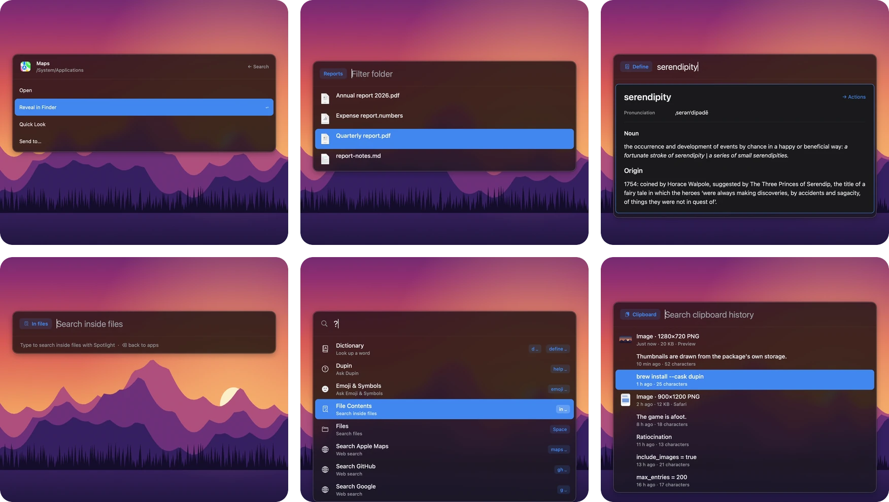

<div align="center">
    
    <h1>Dupin</h1>
    <p><a href="./docs/name.md">/dy.pɛ̃/</a></p>
    <p><strong>The doorway to your Mac: type a keyword, reach anything.</strong></p>
    <p>
        <a href="https://dupin.app">Website</a> ·
        <a href="https://dupin.app/docs/">Docs</a> ·
        <a href="https://dupin.app/download/">Download</a> ·
        <a href="https://github.com/x-ryoppippi/dupin/releases">Releases</a>
    </p>
    
</div>

## Why Dupin

**A launcher should be the doorway to your desktop, not a replacement for it.** [Read the philosophy](./docs/philosophy.md).

- **Fast.** The panel is already drawn when you press the hotkey, and app search shows its results under 3 ms after each keystroke (p95, measured in CI on every change to the app).
- **Built for searching, and simple.** Type a keyword, reach anything; the launcher stays a launcher.
- **Extensible by anyone, agents included.** Extensions are plain TypeScript you write, test and install from Git, sandboxed with the permissions you grant.

## Install

```sh
brew install --cask x-ryoppippi/tap/dupin@nightly
nix profile install github:x-ryoppippi/dupin
```

Free ⌘Space first ([how](./docs/features/hotkeys.md#freeing-the-hotkey)). More ways to install, and everything else, are in the docs.

**Read the docs at [dupin.app/docs](https://dupin.app/docs/).**

---

[GPL-3.0-or-later](./LICENSE) · [Contributing](./CONTRIBUTING.md) · [Telemetry](./docs/features/telemetry.md) · [Sponsor](https://github.com/sponsors/ryoppippi)

## Sponsors

<p align="center">
    <a href="https://coderabbit.link/ryoppippi"><picture><source media="(prefers-color-scheme: dark)" srcset="./docs/public/coderabbit-logo-dark.svg"></picture></a>
    &nbsp;&nbsp;
    <a href="https://blacksmith.sh"><picture><source media="(prefers-color-scheme: dark)" srcset="./docs/public/blacksmith-logo-dark.svg"></picture></a>
</p>

<p align="center">
    <a href="https://github.com/sponsors/ryoppippi">
        
    </a>
</p>
