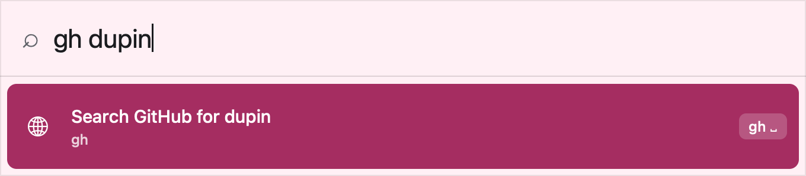

# Appearance

## Backdrop

A shader can animate behind the panel, the query field and its results, while it shows, as Ghostty's `custom-shader` does behind a terminal. `"flow"` is the built-in one, the accent color flowing as warped noise, swelling as you type. `"off"`, the default, draws nothing and leaves the panel plain glass. Anything else is the path to a WGSL file: `~/` is the home directory, and a relative path is relative to `config.toml`.

<picture>
<source media="(prefers-color-scheme: dark)" srcset="../images/settings/appearance-dark.png" />

</picture>

Settings offers `flow`, `off`, the shaders in [`examples/shaders`](../../examples/shaders) and every `.wgsl` file in the `shaders` folder beside `config.toml`; the Shaders folder row on the Appearance page opens it. Picking an example copies it into the folder, unless a copy is already there, and points `backdrop` at the copy, so you can edit it.

Dupin reads the file each time the panel shows and compiles it when its text has changed, so you can edit a shader and see it at the next hotkey press. A file that can't be read or doesn't compile shows its error in the panel at every summon until it's fixed; meanwhile Dupin keeps the last version that compiled, or draws `flow`. [`examples/shaders`](../../examples/shaders) describes how to write one.

The backdrop holds still under System Settings → Accessibility → Display → Reduce motion.

## Themes

Omitting `[theme]` preserves the default panel and follows system light/dark appearance.
Themes are built in: share the TOML section below without installing an extension.

```toml
[theme]
panel_width = 680
row_height = 72
corner_radius = 14
font_family = "monospace" # "system", "monospace", or an installed family's name
font_size = 18

[theme.light]
background = "#E9F4FA"
accent = "#176EA6"

[theme.dark]
background = "#142734"
accent = "#176EA6"
```

Each appearance accepts `background`, `text`, `secondary`, `accent`, `selected_text`,
`hover` and `separator` as `#RRGGBB`. Omitted colors use the system palette. The
background remains a tint over Liquid Glass; headless rendering uses its opaque fallback.
Choose contrasting text and selection colors when overriding the palette.

<picture>
<source media="(prefers-color-scheme: dark)" srcset="../images/appearance/ocean-dark.png" />

</picture>

<picture>
<source media="(prefers-color-scheme: dark)" srcset="../images/appearance/rose-dark.png" />

</picture>

`font_family` is `"system"` (San Francisco), `"monospace"` (SF Mono), or any font
installed on the Mac by the name Font Book shows — `"Menlo"`, `"JetBrains Mono"`,
`"Hiragino Sans"`. A comma-separated list tries each in order, CSS-style:
`"Iosevka, JetBrains Mono"`. A name nothing provides falls back to the system font.
Settings → Appearance lists the installed families in the Font menu; a name only
TOML can express stays there, checked.

Geometry uses integer points: width 400–1200, row height 52–100, radius 0–32 and
font size 12–20. Rows must be at least `3 * font_size + 7` points tall. Invalid
reloads keep the last good configuration and show an error.

Settings → Appearance shows light and dark previews at the configured width (scroll
to see wide panels), with a menu for colors, font and geometry presets. Edit TOML
for precise values. Changes use the usual settings save/conflict handling; the theme
section is one setting for conflict detection. The menu is locked only when a read-only
`config.toml` sets `[theme]`; otherwise edits are saved to `settings.toml`.
Width, rows, colors and typography apply live without clearing the search. Corner
radius requires relaunch because pinned Rune only sets native corners at window creation;
the running panel keeps both its native and drawn corners at the launch radius.

For headless checks, copy one of `scripts/themes/{default,ocean,rose}.toml` to
`$XDG_CONFIG_HOME/dupin/config.toml` under a temporary directory, then run:

```sh
target/debug/dupin --script scripts/themes/preview.json --realtime \
  --snap /tmp/theme.png --at mark:end --size 680x500 --scale 2
```

Use width 400 for Ocean and 900 for Rose. These fixtures disable hotkeys and updates;
never point screenshot runs at your regular configuration. Headless snapshots show
the same resolved colors, fonts and geometry, using the material fallback.

## Configuration

```toml
backdrop = "off" # "off", "flow", or the path to a WGSL shader
```
