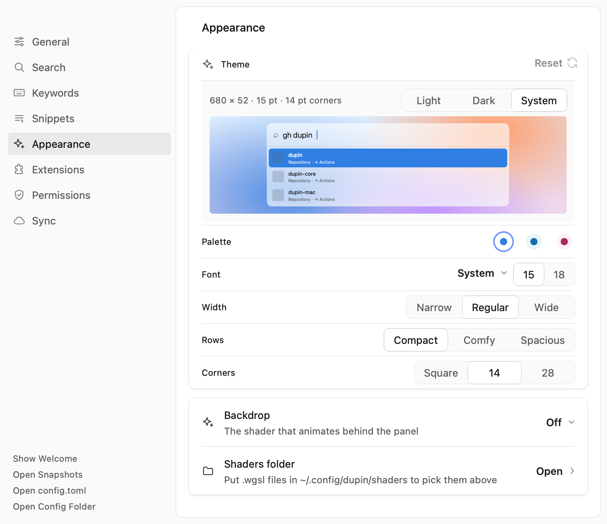
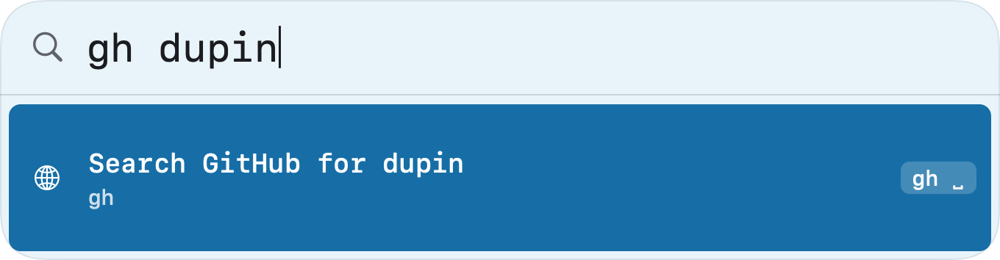

# Appearance

Appearance sets the panel's theme (palette, font and geometry) and an animated backdrop behind it.

## Open it

Open **Settings → Appearance** (<kbd>⌘,</kbd> in the panel), or set `[theme]` and `backdrop` in `config.toml`.

## What you see

- A preview at the configured width, with **Light**, **Dark** and **System** to choose which appearance it shows.
- Menus for **Palette**, **Font**, **Font size**, **Width**, **Rows** and **Corners**, and **Reset**.
- **Backdrop**, the shader behind the panel, and the **Shaders folder** row.

<picture>
<source media="(prefers-color-scheme: dark)" srcset="../images/settings/appearance-dark.png" />

</picture>

## What you can do

| Key / action                  | What it does                                                                                |
| ----------------------------- | ------------------------------------------------------------------------------------------- |
| **Palette**                   | Picks **Default**, **Ocean** or **Rose** palette; a palette set in TOML shows as **Custom** |
| **Font**                      | Picks **System**, **Monospace** or an installed family                                      |
| **Width**                     | Picks **Narrow**, **Regular** or **Wide**                                                   |
| **Rows**                      | Picks **Compact**, **Comfy** or **Spacious**                                                |
| **Corners**                   | Picks **Square**, **14** or **28**; shows **Relaunch to apply** until a relaunch            |
| **Reset**                     | Returns the theme to the default panel                                                      |
| **Backdrop**                  | Picks **Off**, **Flow** or a shader; see [Backdrop](#backdrop)                              |
| **Shaders folder** → **Open** | Opens the `shaders` folder beside `config.toml`                                             |

## Notes

- Width, rows, palette and typography apply live without clearing the search; corner radius needs a relaunch.
- The menus offer presets; edit TOML for precise values.
- The menus are locked only when a read-only `config.toml` sets `[theme]`; otherwise edits are saved in Dupin's [encrypted storage](./storage.md).
- An invalid reload keeps the last good configuration and shows an error.

## Configuration

```toml
backdrop = "off" # "off", "flow", or the path to a WGSL shader

[theme]
panel_width = 680
row_height = 72
corner_radius = 14
font_family = "monospace" # "system", "monospace", or an installed family's name
font_size = 18

[theme.light]
background = "#E9F4FA"
accent = "#176EA6"

[theme.dark]
background = "#142734"
accent = "#176EA6"
```

| Key                                                                                                                 | Range or values                                                                      |
| ------------------------------------------------------------------------------------------------------------------- | ------------------------------------------------------------------------------------ |
| `backdrop`                                                                                                          | `"off"` (default), `"flow"`, or the path to a WGSL file; see [Shaders](./shaders.md) |
| `panel_width`                                                                                                       | 400–1200 points                                                                      |
| `row_height`                                                                                                        | 52–100 points, and at least `3 * font_size + 7`                                      |
| `corner_radius`                                                                                                     | 0–32 points; applies after a relaunch                                                |
| `font_family`                                                                                                       | `"system"` (San Francisco), `"monospace"` (SF Mono), or an installed family          |
| `font_size`                                                                                                         | 12–20 points                                                                         |
| `[theme.light]`, `[theme.dark]`: `background`, `text`, `secondary`, `accent`, `selected_text`, `hover`, `separator` | `#RRGGBB`; an omitted colour uses the system palette                                 |

## Backdrop

A shader can animate behind the panel, the query field and its results, while it shows, as Ghostty's `custom-shader` does behind a terminal. `"off"`, the default, draws nothing and leaves the panel plain glass; `"flow"` is the built-in one, the accent colour flowing as warped noise, swelling as you type. Settings also offers the example shaders and every `.wgsl` file in the `shaders` folder beside `config.toml`.

[Shaders](./shaders.md) covers the examples and how they load; see [Writing your own shader](./shaders.md#writing-your-own-shader) to make one.

## Themes

Themes are built in: share the `[theme]` section without installing an extension. Omitting `[theme]` preserves the default panel and follows system light/dark appearance. Geometry uses integer points. Choose a contrasting colour for text and selection when overriding the palette.

<picture>
<source media="(prefers-color-scheme: dark)" srcset="../images/appearance/ocean-dark.png" />

</picture>

<picture>
<source media="(prefers-color-scheme: dark)" srcset="../images/appearance/rose-dark.png" />

</picture>

<details>
<summary>Fonts and the palette</summary>

`font_family` takes any font installed on the Mac by the name Font Book shows — `"Menlo"`, `"JetBrains Mono"`, `"Hiragino Sans"`. A comma-separated list tries each in order, CSS-style: `"Iosevka, JetBrains Mono"`. A name nothing provides falls back to the system font. Settings → Appearance lists the installed families in the Font menu; a name only TOML can express stays there, checked.

The background remains a tint over Liquid Glass; headless rendering uses its opaque fallback.

</details>

<details>
<summary>Editing in Settings and reloads</summary>

Settings → Appearance shows light and dark previews at the configured width (scroll to see wide panels), with a menu for palette, font and geometry presets. Edit TOML for precise values.

Changes use the usual settings save/conflict handling; the theme section is one setting for conflict detection. The menu is locked only when a read-only `config.toml` sets `[theme]`; otherwise edits are saved in Dupin's encrypted storage. Invalid reloads keep the last good configuration and show an error.

Width, rows, palette and typography apply live without clearing the search. Corner radius requires relaunch because pinned Rune only sets native corners at window creation; the running panel keeps both its native and drawn corners at the launch radius.

</details>

<details>
<summary>Headless theme previews</summary>

For headless checks, copy one of `scripts/themes/{default,ocean,rose}.toml` to `$XDG_CONFIG_HOME/dupin/config.toml` under a temporary directory, then run:

```sh
target/debug/dupin --script scripts/themes/preview.json --realtime \
  --snap /tmp/theme.png --at mark:end --size 680x500 --scale 2
```

Use width 400 for Ocean and 900 for Rose. These fixtures disable hotkeys and updates; never point screenshot runs at your regular configuration. Headless snapshots show the same resolved palette, fonts and geometry, using the material fallback.

</details>
