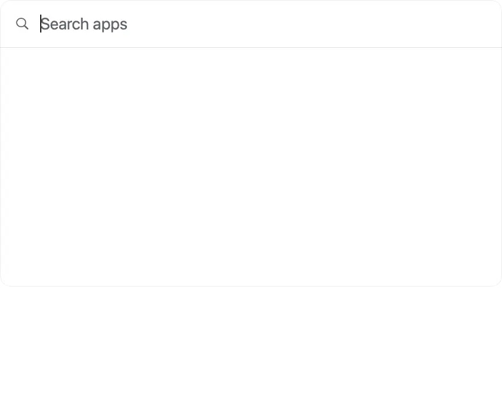

# Apps

Dupin fuzzy-searches your installed apps and opens the one you pick.

## Open it

Show the panel and type part of an app's name.

## What you see

- One row per matching app, closest match first.
- When an app matches through another of its names, that name shows before its folder.
- Executable [script commands](./scripts.md) appear in the same list.

<picture>
<source media="(prefers-color-scheme: dark)" srcset="../images/apps/clip-dark.webp" />

</picture>

## What you can do

| Key / action                                 | What it does                                                   |
| -------------------------------------------- | -------------------------------------------------------------- |
| <kbd>↩</kbd>                                 | Open the app                                                   |
| <kbd>⌘↩</kbd>                                | Reveal it in Finder                                            |
| <kbd>⌘Y</kbd>                                | Preview it with Quick Look                                     |
| <kbd>→</kbd>, <kbd>⌘K</kbd> or <kbd>⌃K</kbd> | Show its actions: Open, Reveal in Finder, Quick Look, Send to… |

Other keys: [Keys](../usage.md#keys).

## Notes

- Dupin finds the `.app` bundles in `/Applications`, `/System/Applications` and `~/Applications`, one folder deep (so `Utilities` is included).
- An app matches by any name macOS knows it by:
  - the name Finder shows, localized (システム設定 for System Settings on a Japanese Mac);
  - its file name, when that differs;
  - Spotlight's alternate names and keywords: ChatGPT answers to "Codex", its former name, System Settings to "System Preferences", Safari to "browser".
- Scripts with arguments open a separate argument field; their output can stay inline or stream into the Script Output window.

Ranking details

Matches rank in four tiers, best first:

1. The whole name, ignoring case, spaces and `.app` (`line` for LINE).
2. A name the query starts, or that has a word the query starts (`ar` for Ardia, `time` for FaceTime: a capital inside a name starts a word).
3. The name's initials, from its first word (`am` for Activity Monitor, `vsc` or `vscode` for Visual Studio Code, `ar` for Music by its other name Apple Radio).
4. Any other name that holds the query's letters in order (`ar` in Calendar).

Within a tier, closer matches come first: initials that start every word before those that skip one or stop short, and an app's own name a little before its other names. Usage moves up the apps you open most and those you opened for the same query, but only within a tier: however often you opened a looser match, it never hides a better one, such as an app whose name starts with what you typed. What you opened for a query counts in full for a few days, then less as it ages, with the same age steps as how often you open an app: an app you once opened for `ar` by mistake gives way to the one you open for it now.

[Recent items](./recent-items.md) · [Keywords](./keywords.md)
