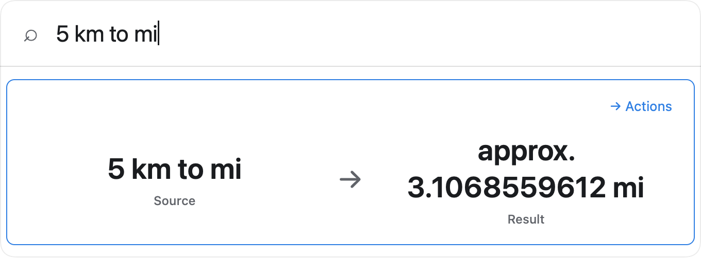

# Calculator

Dupin works out calculations and unit or currency conversions as you type.

## Open it

Type a calculation in app search.

| Try                                       | For                                            |
| ----------------------------------------- | ---------------------------------------------- |
| `12*3`, `2^10`, `(1+2)/3`, `15% of 200`   | Arithmetic                                     |
| `5 km to mi`, `100 f to c`, `1 GiB in MB` | Units                                          |
| `100 USD to JPY`, `€50 in GBP`, `10 GBP`  | Currencies, when on (`10 GBP` converts to EUR) |

## What you see

- The answer, above apps.
- For currencies, the rates' observation date, marked as cached when they have not been refreshed in the past 12 hours.

<picture>
<source media="(prefers-color-scheme: dark)" srcset="../images/calculator/arithmetic-dark.png" />

</picture>

<picture>
<source media="(prefers-color-scheme: dark)" srcset="../images/calculator/units-dark.png" />

</picture>

<picture>
<source media="(prefers-color-scheme: dark)" srcset="../images/calculator/clip-dark.webp" />

</picture>

## What you can do

| Key / action | What it does                                                        |
| ------------ | ------------------------------------------------------------------- |
| <kbd>↩</kbd> | Copy the displayed number, without units or the approximation label |
| **Send to…** | Hand the copyable number on ([Send to](./send-to.md))               |

Other keys: [Keys](../usage.md#keys).

## Notes

- Currency conversion is off by default. When on, Dupin downloads exchange rates in the background; the request contains no search text.
- Only input with a digit in it reaches the calculator, so names and words never do.

## Configuration

```toml
calculator = true # show calculations and unit conversions in app search
calculator_currency = false # allow downloading exchange rates when Calculator is on
```

| Key                   | Default | Meaning                                                                                |
| --------------------- | ------- | -------------------------------------------------------------------------------------- |
| `calculator`          | `true`  | Show calculator results; changes apply immediately. Settings → Search → **Calculator** |
| `calculator_currency` | `false` | Convert currencies in app search. Settings → Search → **Currency conversion**          |

<details>
<summary>Exchange rates</summary>

Dupin itself checks the European Central Bank's public reference feed in the background at most once every 12 hours, and hands the rates to the calculator; the extension never reaches the network. The request contains no search text.

The calculator uses the last good rates offline and shows their observation date. It labels rates as cached if they have not been refreshed in the past 12 hours. Rates are stored in `~/Library/Caches/Dupin/calculator`, or in `$XDG_CACHE_HOME/dupin/calculator` when that variable is set.

</details>

<details>
<summary>How it works</summary>

Calculator is a [bundled extension](./extensions.md#bundled-extensions), `calculator`, that works each calculation out with Dupin's calculator. Dupin hands it what you type in the main search only when it has a digit in it, so names and words never reach it.

Settings → Extensions lists it as a built-in command, with its `query` and `calculator` grants; revoking either stops it answering. `dupin ext eject calculator` copies it to your extensions folder to change it. A changed copy sees nothing you type until you turn it on and allow it `query` in Settings → Extensions.

</details>
