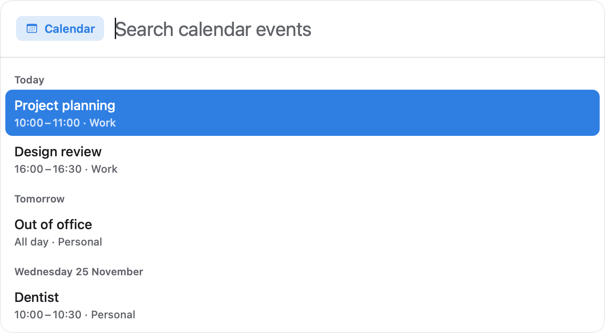

# Calendar

Enable **Calendar search** in Settings → Search. Type `cal`, or an [alias](./keywords.md#aliases) for `calendar`, followed by Space for up to 30 events over the next seven days. To search from 30 days ago to 90 days ahead, type words from the title or location in any order. Each row shows the event time in the Mac's local time zone and its calendar.

<picture>
<source media="(prefers-color-scheme: dark)" srcset="../images/calendar/upcoming-dark.png" />

</picture>

<picture>
<source media="(prefers-color-scheme: dark)" srcset="../images/calendar/clip-dark.webp" />

</picture>

Events are grouped under a heading for their day: Today, Tomorrow, then the weekday and date. An event already under way sits under Today. A typed search lists events that have ended last, under Earlier. Under a day's heading, a row shows only the time, or “All day”; an event that spans more than one day, or is listed under Earlier, also shows its dates, with the year when it is not this year. ↑ and ↓ move between events and skip the headings.

Dupin requests Full Access to Calendars when you enable Calendar search in Settings, or on first use if you enabled it in `config.toml`. You can also request it in Settings → Permissions. If access is denied, the panel and the permission row open System Settings → Privacy & Security → Calendars. Invoke `cal` again after granting access there. Calendar results stay out of Snapshots and search history.

Press Enter to open the original event in Calendar. Dupin uses an undocumented Calendar link. If Calendar cannot resolve an event or recurring occurrence, it may open without selecting it.

## Configuration

Turn on **Calendar search** in Settings → Search, or set `enabled = true` in `[calendar]`. This reserves the `cal` keyword. Turning the setting off removes the command immediately.

Calendar has a second switch: its row in Settings → Extensions, which turns the `calendar` package on or off as it does any extension. `cal` answers only while both are on. **Calendar search** decides whether the command and its keyword exist; the package switch decides whether its extension may run. With Calendar search on and the package off, `cal` says Calendar search isn't available, and the package's row says it is off.

## How it works

Calendar search is the [bundled extension](./extensions.md#bundled-extensions) `calendar`, a TypeScript package in [`extensions/calendar`](../../extensions/calendar) that ships inside Dupin.app. It runs only while **Calendar search** is on, under the `cal` keyword. Settings → Extensions lists it as a built-in command, with where it comes from, its package switch and its grant, as [Configuration](#configuration) describes. It reads events through the [`calendar` capability](./extension-permissions.md#calendar), which the bundled package holds from the start for 30 days back and 90 ahead, and lays them out itself. macOS's Calendars access is still Dupin's to ask for, as above, never the extension's.

The calendar service matches the typed words against each event's title and location, so a keystroke sends only the matching events to the extension. JavaScript in the extension host has no `Intl`, so the service also hands over each event's day, time and dates as this Mac's locale and time zone write them, and the Calendar link Enter opens.

To change how events are listed, copy the package into the extensions folder and edit it:

```sh
dupin ext eject calendar
```

While the extensions folder is on, your copy answers `cal` in place of the bundled one, still behind **Calendar search**, as [Overriding a built-in](./extensions.md#overriding-a-built-in) describes. Once it differs from the bundled package it is a third-party extension: the panel asks you to turn it on and to allow it to read calendars before it shows any events. Delete the copy to go back. `dupin ext test` replays the package's [fixtures](./extension-testing.md#fixtures) in `extensions/calendar/fixtures`.
