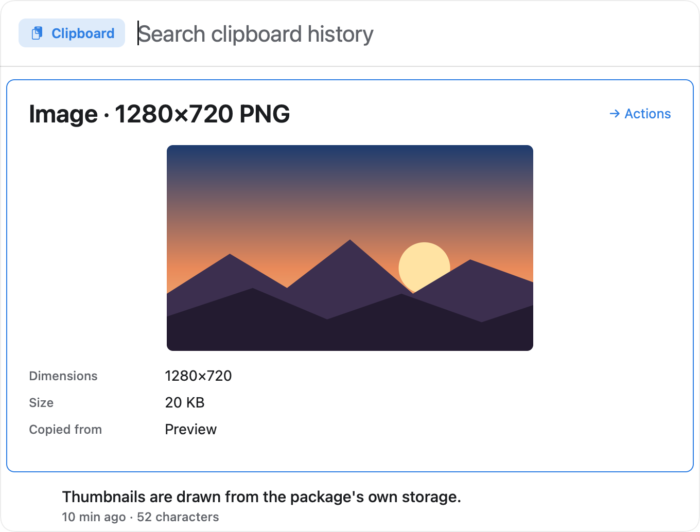
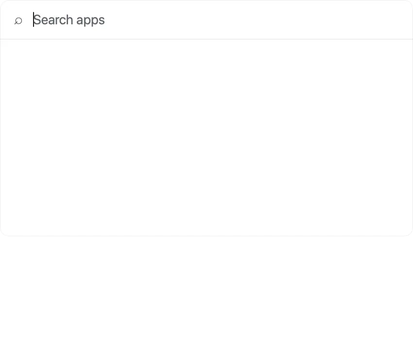

# Clipboard history

Dupin keeps the text, images and files you copy, encrypted, so you can search them and copy or paste them again.

## Open it

Turn on **Clipboard history** in Settings → Search, then type `clip` <kbd>Space</kbd>, or an [alias](./keywords.md#aliases) for `clipboard`, or press a [shortcut](./hotkeys.md#configuration) bound to `clipboard`, such as <kbd>⇧⌘V</kbd>.

## What you see

- A "Clipboard" chip, and your most recent copies first, each with how long ago it was copied.
- **Text**: its first words, up to 200 characters, with its line or character count.
- **Images**: a thumbnail as the icon and "Image · 1280×720 PNG", with its size and the app it was copied from; selected, the image shows large, with its dimensions, size and that app.
- **Files**: their names and the first file's Finder icon, with their folder and size; a thumbnail instead when that file is a picture (PNG, JPEG, HEIC, HEIF or TIFF), and one picture copied on its own shows large while selected, with its folder and size.
- **Unavailable**, without an icon, for a file that has since been moved or deleted.

<picture>
<source media="(prefers-color-scheme: dark)" srcset="../images/clipboard/history-dark.png" />

</picture>

<picture>
<source media="(prefers-color-scheme: dark)" srcset="../images/clipboard/clip-dark.webp" />

</picture>

## What you can do

| Key / action                                 | What it does                                                                                                                                |
| -------------------------------------------- | ------------------------------------------------------------------------------------------------------------------------------------------- |
| Type                                         | Keep only entries containing every word, ignoring case; the list stays newest first                                                         |
| <kbd>↑</kbd> <kbd>↓</kbd>                    | Move through the list, even with an empty query                                                                                             |
| <kbd>↩</kbd> (**Copy**)                      | Copy the entry back to the clipboard as it was copied — the text, the image, or the files as Finder's Copy offers them — and hide the panel |
| <kbd>⌘↩</kbd> (**Paste**)                    | Paste it into the frontmost app instead                                                                                                     |
| <kbd>→</kbd>, <kbd>⌘K</kbd> or <kbd>⌃K</kbd> | Show its actions                                                                                                                            |
| **Reveal in Finder**                         | For files, show them in Finder                                                                                                              |
| **Delete from History**                      | Remove that entry only; the clipboard itself keeps whatever it holds                                                                        |
| **Clear History**                            | Ask for confirmation with Cancel selected, then forget every entry                                                                          |

Other keys: [Keys](../usage.md#keys).

## Notes

- Off by default, because it records what you copy.
- Paste needs Accessibility access; without it the entry is copied and a notice explains how to allow it.
- Copies that password managers and other apps mark as concealed, transient or auto-generated are never read, nor are copies from apps in `ignored_apps`.
- On macOS versions that report the pasteboard access policy, background recording requires **Always Allow** (see [Pasteboard access](#pasteboard-access)).
- Clipboard results can't be saved as snapshots and are not recorded in usage-ranking history. Clipboard search terms are not kept for query recall.
- An Unavailable file can only be deleted from the history.

## Configuration

Turn it on with the switch in Settings → Search, or in `config.toml`. Below it, Settings sets how long copies are kept and whether images and files are recorded; when `[clipboard]` is set in a read-only config layer, these rows are locked.

```toml
[clipboard]
enabled = false # keep what you copy, searchable with `clip`
retention = "7d" # 1d, 7d, 30d, 90d or forever
include_images = true # images and screenshots, converted to PNG
include_files = true # files copied in Finder, kept by their location
max_entries = 200 # 1 to 10000; the oldest entry goes first
max_entry_bytes = 65536 # 1024 to 1048576; larger text is skipped, never truncated
max_image_bytes = 4194304 # 65536 to 33554432; the largest image kept, after converting it to PNG
ignored_apps = [
	"com.apple.keychainaccess",
	"com.apple.Passwords",
	"com.1password.1password",
	"com.agilebits.onepassword7",
	"com.bitwarden.desktop",
]
```

| Key               | Default   | Meaning                                                                          |
| ----------------- | --------- | -------------------------------------------------------------------------------- |
| `enabled`         | `false`   | Keep what you copy, searchable with `clip`                                       |
| `retention`       | `"7d"`    | How long copies are kept: `1d`, `7d`, `30d`, `90d` or `forever`                  |
| `include_images`  | `true`    | Record images and screenshots, converted to PNG                                  |
| `include_files`   | `true`    | Record files copied in Finder, kept by their location                            |
| `max_entries`     | `200`     | 1 to 10000; past it, the oldest entry goes first                                 |
| `max_entry_bytes` | `65536`   | 1024 to 1048576; larger text is skipped, never truncated                         |
| `max_image_bytes` | `4194304` | 65536 to 33554432; the largest image kept, after converting it to PNG            |
| `ignored_apps`    | as above  | Bundle identifiers whose copies are never read; setting it replaces the defaults |

Find an app's identifier with `osascript -e 'id of app "Name"'`.

<details>
<summary>What is recorded</summary>

While it is on, Dupin checks the clipboard's change count twice a second on a background thread and hands each new copy to the history as one kind: the files copied in Finder, else a link, else plain text, else an image. Rich text is recorded as its plain text, and a link as its text. Copies already on the clipboard when the history is turned on are not recorded. Copying something already in the history moves it to the top.

- **Images** are read from PNG, TIFF, HEIC, HEIF or JPEG on the clipboard and kept as PNG; a copy whose bytes aren't the image type it claims is skipped. An image larger than 4096 pixels on its longest side is scaled down to it; one whose PNG is still larger than `max_image_bytes` is skipped. A PNG that already fits is kept byte for byte. The image never passes through the extension: Dupin stores it beside the entry. Images share the history's 64 MB and 10,000 records of storage with text and files. When a copy doesn't fit, the oldest images make room first; an image that still doesn't fit is skipped, since text and files are never dropped to make room for images, while text or files then take the place of the oldest entries of any kind.
- **Files**, including videos, are never copied or read. Dupin hands over each file's path, name, folder, size and type, so a file larger than the history is never duplicated. The history can put back only files Dupin handed it.
- **Text** larger than `max_entry_bytes` is skipped rather than kept in part.

Turning off `include_images` or `include_files` forgets the entries of that kind already kept the next time the history is listed. Entries older than `retention` are deleted when the history lists them: as you search it after the settings change, and within the hour otherwise. Past `max_entries`, the oldest entry is deleted as a copy is recorded.

</details>

<details>
<summary>Searching</summary>

Text matches anywhere. Images match `image`, `png`, their dimensions (`1280x720` or `1280×720`), their size (`1.2 mb`) and the name of the app they were copied from. Files match their names and full paths.

Dupin holds at most 8 MB of a history's text in memory to match it: past that, the newest entries are still found by all their text and older ones by as much of their beginning as fits, and when even that runs short, their first words are shortened.

Thumbnails are drawn from the history's encrypted storage, or for files from the file itself, only for the entries on screen and a screenful either side, so a history of thousands of images keeps only a screenful of them in memory. The pictures never pass through the extension: it names each by the handle Dupin gave it, as [images](./extension-api.md#images) describes.

</details>

<details>
<summary>Security details</summary>

Copies marked concealed, transient or auto-generated ([nspasteboard.org](http://nspasteboard.org) types) are never read. Nor are copies that name an app in `ignored_apps` as their source, or that land while such an app is frontmost: Dupin checks the apps frontmost at the polls just before and just after a copy, so switching apps several times within half a second can slip past it. Rely on the concealed marker, which password managers set, for secrets.

`retention`, `include_images`, `include_files` and `max_entries` reach the extension as its preferences; `max_entry_bytes`, `max_image_bytes` and `ignored_apps` are the clipboard service's own, which every extension that reads or watches the clipboard follows too.

</details>

### Pasteboard access

On macOS versions that report the pasteboard access policy, background recording requires **Always Allow**. Under the default policy, `clip` offers a one-time clipboard read so macOS can prompt and list Dupin in System Settings. If macOS is set to ask or deny, the row opens Privacy & Security, where you can always allow Dupin to paste from other apps.

## Storage

The history is kept across restarts in the extension's own [encrypted storage](./storage.md) namespace, sealed with the data key in your Keychain. It is never written to disk unencrypted, included in snapshots or logged. Dupin holds the list it shows in memory only, and lists it again from storage after a restart.

<details>
<summary>Deleting</summary>

Deleting an entry, clearing the history and turning it off delete what storage holds as well as what Dupin shows: turning the history off deletes the whole namespace, the bundled extension's and that of a copy of it in the extensions folder. Dupin deletes both again each time it starts with the history off, so turning it off in `config.toml` while Dupin is quit, or quitting before a deletion has finished, leaves nothing behind either.

</details>

<details>
<summary>How it works</summary>

Clipboard history is the bundled extension [`extensions/clipboard-history`](../../extensions/clipboard-history), written in TypeScript against the same [extension platform](./extensions.md) as any other. It runs only while **Clipboard history** is on, under the `clip` keyword. Settings → Extensions lists it as a built-in command, with where it comes from, its package switch and its grants; `clip` answers only while both switches are on, and with the package off it says clipboard history isn't available.

Dupin hands it each copy through its clipboard watch, and it keeps the history in its own encrypted storage and hands Dupin the list, which Dupin matches as you type without running the extension.

`dupin ext eject clipboard-history` copies it to the extensions folder; the copy then answers `clip` in its place, still behind **Clipboard history**, as [Overriding a built-in](./extensions.md#overriding-a-built-in) describes. Once it differs from the bundled package it is third-party code with grants of its own.

</details>
