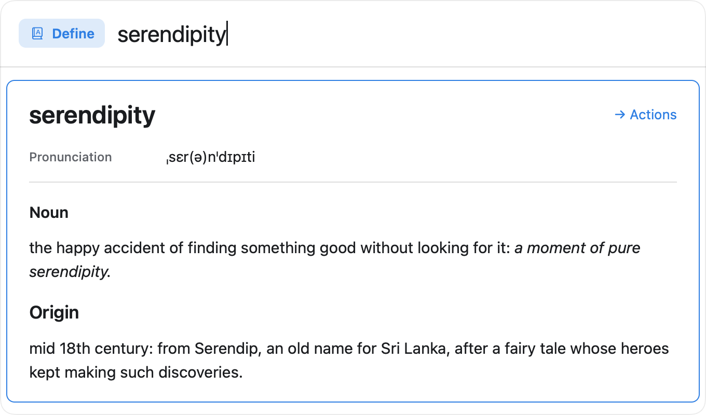

# Dictionary

Dupin looks words up in the dictionaries enabled in Dictionary.app.

## Open it

`define` <kbd>Space</kbd> or `d` <kbd>Space</kbd>, then type a word.

## What you see

- A "Define" chip.
- The entry, laid out from Dictionary.app's text: pronunciation, parts of speech with numbered senses, examples in italics, and parts such as Phrases and Origin under their own headings.
- No definition found, for a word no dictionary has.

<picture>
<source media="(prefers-color-scheme: dark)" srcset="../images/dictionary/entry-dark.png" />

</picture>

<picture>
<source media="(prefers-color-scheme: dark)" srcset="../images/dictionary/clip-dark.webp" />

</picture>

## What you can do

| Key / action                                                   | What it does                                     |
| -------------------------------------------------------------- | ------------------------------------------------ |
| <kbd>↩</kbd>                                                   | Open the word in Dictionary.app                  |
| <kbd>→</kbd>, <kbd>⌘K</kbd>, <kbd>⌃K</kbd> or the Actions link | Show its actions                                 |
| **Open in Dictionary**                                         | Open the word in Dictionary.app                  |
| **Copy Definition**                                            | Copy the definition as the dictionary wrote it   |
| **Send to…**                                                   | Hand the definition on ([Send to](./send-to.md)) |
| <kbd>⌫</kbd> on an empty query                                 | Return to app search                             |

Other keys: [Keys](../usage.md#keys).

## Notes

- `define` answers only while the `dictionary` package switch in Settings → Extensions is on; with it off, Dictionary says it isn't available.

## Configuration

```toml
dictionary_keywords = ["define", "d"] # type any keyword, then Space, to look up a word
```

| Key                   | Default           | Meaning                                                                                                    |
| --------------------- | ----------------- | ---------------------------------------------------------------------------------------------------------- |
| `dictionary_keywords` | `["define", "d"]` | Aliases for Dictionary search; add, remove or replace entries. Valid edits take effect without relaunching |

You can also add an alias in [`[aliases]`](./keywords.md#aliases) or Settings → Keywords.

<details>
<summary>Alias rules</summary>

Aliases must be non-empty, have no leading or trailing whitespace and leave other commands' keywords, such as `in`, available. Dupin reports invalid or conflicting aliases in the panel and ignores those entries; the other aliases still work.

</details>

<details>
<summary>How entries are laid out</summary>

Dupin lays the entry out from Dictionary.app's text:

- the pronunciation beside a label;
- each part of speech (noun, verb, …) under a subheading with its numbered senses (1 2 3 or ① ② ③) as a numbered list;
- the sub-senses after each `•` nested under their sense;
- examples after a sense's colon or a `▸` in italics;
- antonyms labeled in bold;
- parts such as Phrases and Origin under their own headings.

Text in any other layout shows as paragraphs, so nothing is left out.

</details>

<details>
<summary>How it works</summary>

Dictionary is the [bundled extension](./extensions.md#bundled-extensions) `dictionary`, in TypeScript in the repository's [`extensions/dictionary`](../../extensions/dictionary). It looks each word up with the extension [`dictionary` capability](./extension-permissions.md#dictionary), which reads Dictionary Services and lays the entry out in Dupin, and shows the entry's Markdown as the row's detail.

It answers Dictionary's own command, so `dictionary_keywords` choose its keywords, the `keyword` in its `package.json` is never used, and Settings → Extensions lists it as a built-in command, with where it comes from, its package switch and its grant. If it can't load, Dictionary's keywords say so instead of searching.

</details>

<details>
<summary>Changing it</summary>

Copy it into the extensions folder and edit the copy:

```sh
dupin ext eject dictionary
```

While the extensions folder is on, your copy answers Dictionary's keywords in place of the bundled one, as [Overriding a built-in](./extensions.md#overriding-a-built-in) describes. Once it differs from the bundled package, it is a third-party extension: the panel asks you to turn it on and to allow it to look words up before it shows any definition. Its fixtures run with `dupin ext test ~/.config/dupin/extensions/dictionary`.

</details>
