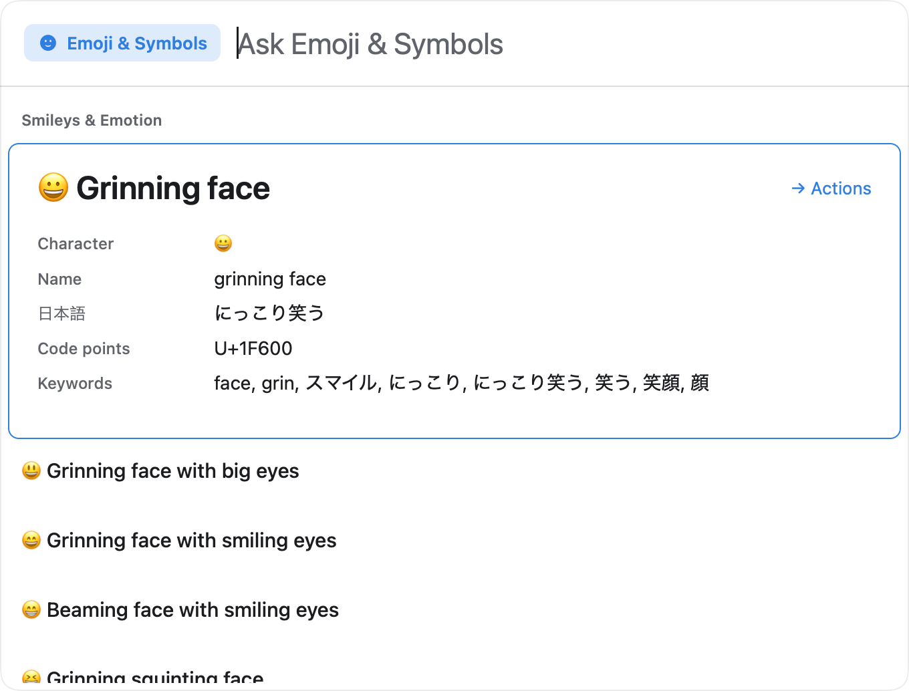

# Emoji & Symbols

Dupin picks emoji and symbols by name or keyword, in English or Japanese.

## Open it

`emoji` <kbd>Space</kbd>, then type a name or keyword: `thumbs`, `euro`, `にっこり` or `日本`.

## What you see

- An "Emoji & Symbols" chip.
- With nothing typed, every character under its Unicode group, starting with Smileys & Emotion and ending with Text Symbols such as `€`, `→`, `±` and `≠`.
- Once you type, one list ranked as apps are, with the emoji you pick most often for a query first.
- For the selected row: the character, its name, its Japanese name, its code points and the keywords that find it.

<picture>
<source media="(prefers-color-scheme: dark)" srcset="../images/emoji/browse-dark.png" />

</picture>

<picture>
<source media="(prefers-color-scheme: dark)" srcset="../images/emoji/search-dark.png" />

</picture>

<picture>
<source media="(prefers-color-scheme: dark)" srcset="../images/emoji/clip-dark.webp" />

</picture>

## What you can do

| Key / action                                                   | What it does                                                                             |
| -------------------------------------------------------------- | ---------------------------------------------------------------------------------------- |
| <kbd>↩</kbd>                                                   | Copy the character and close the panel                                                   |
| <kbd>→</kbd>, <kbd>⌘K</kbd>, <kbd>⌃K</kbd> or the Actions link | Show its other actions                                                                   |
| **Copy**                                                       | Copy the character                                                                       |
| **Paste**                                                      | Paste it into the app you were using                                                     |
| **Copy 👍🏻 light skin tone**, and so on                         | For an emoji that takes a skin tone, copy it in each of the five tones, light to dark    |
| **Send to…**                                                   | Hand the character to another feature, as any text result does ([Send to](./send-to.md)) |
| <kbd>⌫</kbd> on an empty query                                 | Return to app search                                                                     |

Other keys: [Keys](../usage.md#keys).

## Notes

- Paste needs Accessibility access; without it, the character is copied and a notice explains why ([Permissions](./permissions.md#extensions)).
- The list holds Emoji 15.1, which macOS 14.4 and later draw, with names and keywords from CLDR 45.
- Typing never runs extension code: Dupin holds the whole list and matches it itself.

## Configuration

Emoji & Symbols is a [bundled extension](./extensions.md#bundled-extensions) called `emoji`: it ships inside Dupin and is on from the start, whether or not the extensions folder is on. Its switch is in Settings → Extensions; it has no `config.toml` key.

<details>
<summary>Group order</summary>

With nothing typed, the list starts with Smileys & Emotion and runs in Unicode's order under its groups: People & Body, Animals & Nature, Food & Drink, Travel & Places, Activities, Objects, Symbols and Flags, then Text Symbols, such as `€`, `→`, `±` and `≠`, that aren't emoji.

</details>

<details>
<summary>Permissions</summary>

It declares one capability, `clipboard:paste`, which Paste needs and which the bundled copy holds from the start; Settings → Extensions can revoke it, and Settings → Permissions lists it under Accessibility.

</details>

<details>
<summary>Changing it</summary>

To change it, such as to add your own keywords or other characters, copy it into the extensions folder and edit it there:

```sh
dupin ext eject emoji
```

Your copy replaces the bundled one while the extensions folder is on; deleting it brings the bundled one back. [Extensions](./extensions.md#bundled-extensions) describes how a changed copy is treated.

</details>

<details>
<summary>How it is built</summary>

The package is [`extensions/emoji`](../../extensions/emoji): `main.ts` hands Dupin the list through [`items()`](./extension-api.md#itemsctx) from `catalogue.ts`, which `scripts/generate.nu` writes from Unicode's `emoji-test.txt` and CLDR's English and Japanese annotations. Fully-qualified emoji outside the Component group are listed once each; an emoji's five single-tone variants become its skin-tone actions, and variants that mix tones are left out. Text Symbols are the characters CLDR annotates that aren't emoji or ASCII. `fixtures/` holds the [`dupin ext test`](./extension-testing.md#testing-and-snapshots) replays of browsing, English and Japanese searches, symbols, and each action.

Moving to a newer Unicode or CLDR release means running the generator with `--emoji` and `--cldr` and committing what it writes. Only move as far as the oldest supported macOS draws.

</details>
