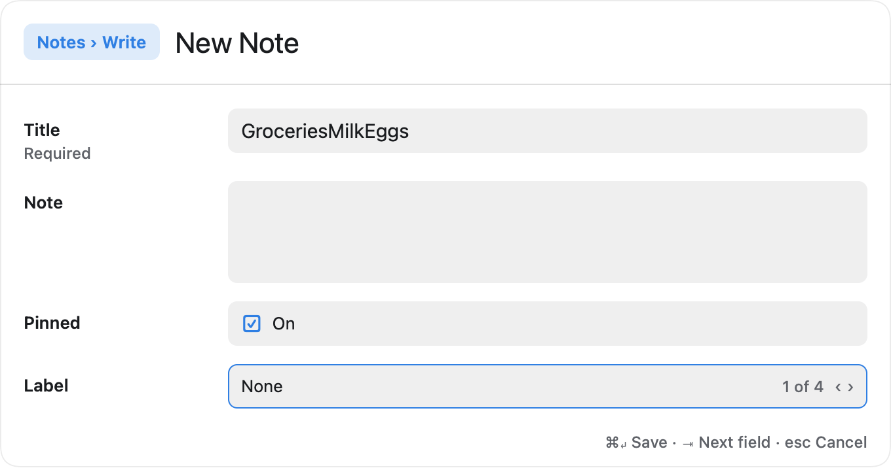

# Extension API

An extension's module exports what Dupin calls: `search` answers each query, `items` hands Dupin a catalogue it matches itself, and `actions`, `views` and `events` handle what you choose, the pages the package opens and what Dupin watches for it. [`sdk/dupin.d.ts`](../../sdk/dupin.d.ts) declares all of it.

```js
export function search(query) {
	const input = query.trim();
	if (!input) return [];
	const count = input.split(/\s+/u).length;
	return [{ title: `${count} words`, text: String(count) }];
}
```

| Export               | Dupin calls it                                             | Returns                                                    |
| -------------------- | ---------------------------------------------------------- | ---------------------------------------------------------- |
| `search(query, ctx)` | On every keystroke after the keyword                       | [Items](#searchquery-ctx), a list or sections              |
| `items(ctx)`         | On first use, then after `ttl` or `items.invalidate()`     | A [catalogue](#itemsctx) Dupin matches itself              |
| `actions`            | When you choose a `run` action or submit a form            | A toast, `hide`, `paste` or an [effect](#effects-on-pages) |
| `views`              | When a `push` opens a page                                 | A [list, detail or form](#views-and-forms)                 |
| `events`             | When something Dupin watches for the package happens       | Nothing; see [Events](#events)                             |
| `filters`            | When [`[advanced]`](./advanced.md#extensions) composes one | Matches or an order                                        |

The manifest is on [Extension manifest](./extension-manifest.md) and the host services on [Extension capabilities](./extension-permissions.md).

<details>
<summary>search or items</summary>

The module exports `search`, `items` or both; each may be a function or an `async` function. Use `search` for what has to be computed from the query, such as a calculation or a lookup, and `items` for a list such as bookmarks or clipboard history, which Dupin matches as you type with the same matcher and usage ranking as apps, without running the package. A package with both lists what `search` computes for the query first, then the catalogue's matches.

</details>

## `search(query, ctx)`

`search` receives the text typed after the keyword and returns items; return `[]` for no results.

| Item field | Meaning                                                    |
| ---------- | ---------------------------------------------------------- |
| `title`    | Required. One line, up to 512 bytes.                       |
| `subtitle` | Up to 2,048 bytes.                                         |
| `url`      | **Open URL** opens it.                                     |
| `text`     | **Copy** copies it, up to 16 KiB.                          |
| `icon`     | An image in the package, or `sf:` and an SF Symbol's name. |
| `detail`   | Shown while the row is selected; see [Details](#details).  |
| `actions`  | More actions; see [Actions](#actions).                     |

<details>
<summary>What it receives and returns</summary>

`search` receives the text typed after the keyword and a frozen `ctx` whose `limit` is the number of rows Dupin will show. It returns an array of items, `{ type: "list", items: [...] }`, or `{ sections: [{ title, items }, ...] }` for items under headings (`type` may be left out). It isn't called before anything is typed unless the manifest sets [`emptyQuery`](./extension-manifest.md).

Enter runs the first action: **Open URL** when the item has a `url`, then **Copy** when it has `text`, then its `actions` in order. → or ⌘K lists them all.

</details>

<details>
<summary>Every item field</summary>

| Item field    | Limit                       | Meaning                                                                                                                                |
| ------------- | --------------------------- | -------------------------------------------------------------------------------------------------------------------------------------- |
| `title`       | One line, 512 bytes         | Required.                                                                                                                              |
| `subtitle`    | 2,048 bytes                 |                                                                                                                                        |
| `id`          | 128 bytes                   | Unique among the items. Optional for `search`, where Dupin numbers items without one; required for `items`.                            |
| `url`         | 2,048 bytes                 | An `http`, `https` or `dict://` URL, or from `search` an event's [`link`](./extension-permissions.md#calendar): **Open URL** opens it. |
| `text`        | 16 KiB                      | **Copy** copies it.                                                                                                                    |
| `icon`        |                             | An image in the package or `sf:` and an SF Symbol's name, such as `sf:star.fill`.                                                      |
| `image`       |                             | A stored image, by its handle, in place of `icon`; see [Images](#images).                                                              |
| `section`     | One line, 128 bytes         | The heading the item is listed under.                                                                                                  |
| `detail`      |                             | `{ image, markdown, metadata }`, shown while the row is selected; see [Details](#details).                                             |
| `actions`     | Eight in all                | More actions, after the ones `url` and `text` add; see [Actions](#actions).                                                            |
| `accessories` | Three                       | At the row's end; see [Accessories](#accessories).                                                                                     |
| `answer`      | One or two lines, 512 bytes | From `search` or a [view](#views-and-forms) only: shown beside the `title` as two values, as a calculation is.                         |

</details>

<details>
<summary>Item rules</summary>

- `icon` is an image in the package, relative to `package.json`, such as `assets/repo.png`: a `.png`, `.jpg`, `.jpeg`, `.svg`, `.pdf` or `.icns` file. An `sf:` symbol is drawn in the colour of the row's text; a name macOS has no symbol for draws nothing.
- Items of a list's `sections` get their section's title as `section`.
- An item without any action shows but does nothing; a [`push`](#views-and-forms) action opens a view of the package's own.
- Every value is checked. An unknown field, a value of the wrong type, an empty `text` or a URL with another scheme fails the whole answer with a row that says which item and field.

</details>

### Accessories

Up to three accessories sit at a row's end, each an object with one key:

| Accessory       | Shows                                                                                                                                     |
| --------------- | ----------------------------------------------------------------------------------------------------------------------------------------- |
| `{ text }`      | The text as it is: one line of up to 64 bytes.                                                                                            |
| `{ tag }`       | The text as a label in the accent colour: one line of up to 64 bytes.                                                                     |
| `{ freshness }` | How long ago the row's data was read, from milliseconds since the epoch as `Date.now()` gives them: `12 s ago`, `5 min ago`, `2 h ago`.   |
| `{ state }`     | `"offline"`, shown as a red **Offline** label, for a source that can't be reached, or `"stale"`, an orange **Stale** label, for old data. |

<details>
<summary>Freshness and state</summary>

Dupin writes a freshness each time it draws the row, by its own clock, so a row from a catalogue Dupin holds says how old it is now rather than when `items` answered; a time ahead of the clock reads as `0 s ago`. `dupin ext render` and `dupin ext test` use the fixture's clock. The words and colours are Dupin's, the same for every package in light and dark, so a package says what state a row is in rather than how to draw it.

```js
export async function items() {
	const read = Date.now();
	const { ok, services } = await poll();
	return {
		ttl: 10,
		items: services.map((service) => ({
			id: service.name,
			title: service.name,
			accessories: [{ freshness: read }, ...(ok ? [] : [{ state: 'offline' }])],
		})),
	};
}
```

</details>

## `items(ctx)`

`items` returns the whole catalogue, which Dupin keeps and matches as you type, ranked with usage as apps are. Every item needs an `id` that stays with it as the list changes.

```js
export function items() {
	return {
		ttl: 3600,
		items: [
			{
				id: 'dupin',
				title: 'Dupin',
				keywords: ['launcher'],
				url: 'https://github.com/x-ryoppippi/dupin',
			},
		],
	};
}
```

| Field       | Meaning                                                      |
| ----------- | ------------------------------------------------------------ |
| `ttl`       | Seconds, 1 to 86,400, before Dupin asks again.               |
| `keywords`  | Up to 16 more words that find the item.                      |
| `time`      | When the item is from; the subtitle starts with `5 min ago`. |
| `webSearch` | Makes the item a [web search](#web-searches).                |

<details>
<summary>How the catalogue is listed and ranked</summary>

`items` returns an array of items, or a list with `items` or `sections` as for `search`. It runs on first use, and again only after its `ttl` or when one of its actions or event handlers invalidates it.

Typing the keyword and Space (such as `bm`) lists the catalogue in its own order, under its sections. Typing more ranks every item by how well its title or keywords match, as apps are ranked, and puts the items you pick most often for that query first; the headings then give way to one ranked list.

Every catalogue item needs an `id` that stays with it as the list changes: Dupin applies updates by it and remembers which items you pick by it, so a position would hand one item's history to whatever takes its place.

</details>

<details>
<summary>List fields and ctx</summary>

| List field | Value                                                                                                                                      |
| ---------- | ------------------------------------------------------------------------------------------------------------------------------------------ |
| `ttl`      | Seconds, 1 to 86,400. Dupin asks again on the first use after they pass. Without it, the catalogue stays until it is invalidated.          |
| `cursor`   | Up to 256 bytes of the package's choosing, handed back as `ctx.cursor` the next time Dupin asks.                                           |
| `more`     | `true` when this is only the first part: Dupin asks again at once with `ctx.reason` `"more"` and the cursor, and keeps the parts together. |

`ctx` is frozen:

| `ctx` field   | Value                                                                                                                                                       |
| ------------- | ----------------------------------------------------------------------------------------------------------------------------------------------------------- |
| `cursor`      | The last answer's, or `null` when Dupin holds nothing.                                                                                                      |
| `reason`      | `"load"` when Dupin holds no catalogue, `"more"`, `"expired"` after `ttl`, or `"invalidated"` after an action or event handler called `items.invalidate()`. |
| `preferences` | The package's [preferences](./extension-manifest.md#preferences).                                                                                           |

</details>

<details>
<summary>Catalogue item fields</summary>

| Item field  | Value                                                                                                                                         |
| ----------- | --------------------------------------------------------------------------------------------------------------------------------------------- |
| `keywords`  | Up to 16 words of up to 64 bytes that find the item as well; a match ranks just below the same match on the title, as an app's alias does.    |
| `aliases`   | Other names, such as a short code, under the same limits, that rank as the title does.                                                        |
| `matchText` | Up to 64 KiB of text that [matching words](#matching-words) finds the item by; it never shows.                                                |
| `time`      | Milliseconds since the epoch, as `Date.now()` gives them. The subtitle starts with how long ago that was, written each time: `5 min ago · …`. |
| `file`      | An absolute path: the item shows that file's Finder icon and shows as **Unavailable** while the file is gone.                                 |
| `webSearch` | Makes the item a [web search](#web-searches).                                                                                                 |

An item with `file` shows that file's Finder icon unless it has an `icon` or an `image`, and while the file is gone it shows as **Unavailable**, without its icon or image or its `needsFile` actions. The item only shows the file: Dupin adds none of the actions it offers on a file it found itself, such as Open, Move to Trash or sharing it from Send to…, since the extension, not Dupin, chose the path.

</details>

<details>
<summary>Parts, sizes and timing</summary>

One answer carries at most 500 items and 1 MiB of text, so a larger catalogue comes in parts with `more`. Dupin takes as many parts as a full catalogue needs when each ends at its items or its text, 29, and drops the catalogue when more keep coming. Every part, the first included, must arrive within the 2 seconds Dupin gives the search that asked, so parts make room for more items, not more time.

Dupin holds each catalogue in memory, at most 10,000 items and 8 MiB of text, and 24 MiB across all extensions; past that, the least recently used catalogue is dropped and asked for again when next used. Reloading the package, including any edit to its files, starts an empty catalogue. Nothing is written to disk: a catalogue costs one call to rebuild after Dupin starts, and keeping it would leave what a package lists, such as clipboard history, on disk beyond the package's say. A list that must outlast a restart lives in the package's [`storage`](./extension-permissions.md#storage), which `items` reads.

A change of preferences drops the catalogue, so the next use lists it with them.

</details>

<details>
<summary>What items may use</summary>

`items` reaches host services as `search` does. It runs while you type, never because you chose an action, so it may use what you allowed that needs no action of yours (files, GET and HEAD, the dictionary, calendars and `storage`, whose writes and deletes need none either), and anything that needs an action you chose, such as reading the clipboard, fails with `needs-activation`. A request that needs consent shows its question under the keyword.

A catalogue belongs to the access it was read under: revoking a scope or turning the extension off drops it, allowing a scope drops it too, and either way the next use asks for it from the start with `reason` `"load"`.

</details>

<details>
<summary>Example with sections</summary>

```js
export function items() {
	return {
		ttl: 3600,
		sections: [
			{
				title: 'Projects',
				items: [
					{
						id: 'dupin',
						title: 'Dupin',
						keywords: ['launcher'],
						url: 'https://github.com/x-ryoppippi/dupin',
					},
				],
			},
		],
	};
}
```

</details>

### Updates

An answer of `{ type: "update", … }` changes the catalogue Dupin holds by `id` (`prepend`, `append`, `replace`, `remove`) instead of sending everything again.

<details>
<summary>Update fields, example and edge cases</summary>

A long and busy list such as clipboard history never sends everything again:

```js
export function items(ctx) {
	if (ctx.reason === 'load') return { items: everything(), cursor: latest() };
	return {
		type: 'update',
		append: since(ctx.cursor),
		remove: forgotten(ctx.cursor),
		cursor: latest(),
	};
}
```

| Update field | Does                                                               |
| ------------ | ------------------------------------------------------------------ |
| `prepend`    | Adds items Dupin doesn't hold before the others, in its own order. |
| `append`     | Adds them after the others.                                        |
| `replace`    | Swaps the items with those IDs in place.                           |
| `remove`     | Lists IDs to drop.                                                 |

An ID Dupin doesn't hold is ignored in `remove`, and an ID removed may come back in the same update, so removing and prepending it moves it to the top. An update that adds an ID Dupin already holds, or replaces one it doesn't, is refused whole: Dupin shows the failure, drops the catalogue and asks again from the start, with `reason` `"load"` and no cursor. So does any failure of `items`.

</details>

### Matching words

With `"match": "words"` in the manifest, typing keeps the items that hold every word typed, in the catalogue's own order.

<details>
<summary>Details</summary>

Matching ignores case and looks anywhere in an item's title, keywords or `matchText`, with the words highlighted in the title. Picks never reorder such a catalogue, and its items are left out of usage ranking.

</details>

### The main search

With `"defaultSearch": true` in the manifest, the catalogue also answers the main search, after apps, with up to eight rows. The package never sees what you type there.

<details>
<summary>How it is matched and loaded</summary>

Rows come after apps and in the order of the extension folders, ranked by the same matcher. Dupin matches the catalogue it holds, so `search` is never called for it.

Loading the catalogue from the main search reaches host services as it does under the keyword, but the main search never asks for consent: a catalogue that fails to load, for want of consent or otherwise, stays out of it and shows its failure, and any question, under its own keyword. The main search doesn't ask a failed catalogue again until its access changes, something invalidates it or its keyword loads it, so it costs no call per keystroke.

</details>

### Web searches

A catalogue item with `webSearch` is a [web search](./web-searches.md): Dupin fills and opens its URL itself, so typing one calls into no package.

```js
webSearch: { alias: 'docs', url: 'https://doc.rust-lang.org/std/?search={query}', title: 'Search Rust documentation for {query}' }
```

<details>
<summary>Fields, example and rules</summary>

```js
export function items() {
	return [
		{
			id: 'docs',
			title: 'Search Rust documentation',
			subtitle: 'docs',
			webSearch: {
				alias: 'docs',
				url: 'https://doc.rust-lang.org/std/?search={query}',
				title: 'Search Rust documentation for {query}',
				fallback: 0,
			},
		},
	];
}
```

| `webSearch` | Value                                                                                                                                    |
| ----------- | ---------------------------------------------------------------------------------------------------------------------------------------- |
| `alias`     | Required. Up to 32 ASCII letters, digits, `_` or `-`, matched case-sensitively. A keyword, and an earlier item's alias, take precedence. |
| `url`       | Required. An `http` or `https` URL with one `{query}`, or exactly `maps://?q={query}`, which opens Apple Maps.                           |
| `title`     | Required. The row's title once a query is typed: one line with one `{query}`, which the query replaces as typed.                         |
| `fallback`  | Optional, 0 to 1,000. The item is offered, lowest first, with the query when nothing else matches the main search.                       |

The item takes no `url`, `text` or `actions`. The package's own keyword lists every web search, filled with what you type.

- `url` is at most 4,096 bytes, with a host, no credentials and its one `{query}` in its path, query or fragment, which Dupin percent-encodes as UTF-8.
- Only the bundled [Web Search](./web-searches.md) package's web searches, or an unchanged copy's, reach the main search and Send to: any other package's stay under its keyword, and Dupin logs that once.
- In the main search, typing `docs` shows the item first, with its own `title`, and Tab completes it to `docs` and a space; `docs rust` shows `Search Rust documentation for rust`, and Enter opens the URL in the browser.
- A Maps search needs a query.
- Each such web search is also offered by Send to for text.
- Web searches never count towards usage ranking.

</details>

## Details

An item's `detail` is shown in place of its row while it is selected, as Dictionary's entries are: `{ image, markdown, metadata }`, under the item's title.

<details>
<summary>Detail fields</summary>

| Detail field | Limit      | Value                                                                                                                                                      |
| ------------ | ---------- | ---------------------------------------------------------------------------------------------------------------------------------------------------------- |
| `image`      |            | A stored image, by its handle, shown large above the metadata; see [Images](#images).                                                                      |
| `markdown`   | 32 KiB     | Headings, paragraphs, bold, italic, lists, inline and fenced code and `http` or `https` links, which Dupin opens when you press them. Raw HTML stays text. |
| `metadata`   | 12 entries | `{ label, text }`, each one line, `label` up to 64 bytes and `text` up to 512, shown above the Markdown.                                                   |

</details>

## Images

An item's `image`, and its detail's, names a picture the package keeps by a handle, never by its bytes: a stored blob's `handle`, or `{ path, handle }` for a file a [clipboard watch](#events) delivered.

<details>
<summary>How images are read and drawn</summary>

A catalogue of thousands of images costs a few dozen bytes a row. The handle is either:

- a stored blob's `handle`, as [`storage`](./extension-permissions.md#storage) returns it in a record's `blobs`, such as a clipboard image stored by its token;
- `{ path, handle }`, a file a clipboard watch delivered, with the `handle` it came with.

In a row the image takes the icon's square, keeping its shape; in a detail it is shown up to 200 points high, as wide as the card.

Dupin reads the image from the package's own storage namespace when it draws the row, never from another package's: a handle that isn't the package's own, or a file handle that doesn't match its path, draws nothing. Reading needs the `storage` grant, but a refusal asks nothing and shows no question; the row is drawn without its image.

Dupin decodes the image with macOS's ImageIO only when its bytes and the type ImageIO finds are PNG, TIFF, HEIC, HEIF or JPEG, so no other codec parses what a package stored; any other image, or one that doesn't decode, is left out like a refused one, and a detail then keeps no space for it. It reads images up to 64 MiB and 64 megapixels, and scales each down to the size it shows at on a worker thread. It does so only for the rows on screen and a screenful either side, and for the selected row's detail, and keeps a screenful of thumbnails and the last three previews in memory, so scrolling a long history reads only what comes into view.

</details>

## Actions

An item's `actions` adds up to eight actions, counting the ones `url` and `text` make. Each has a `title` and one of:

| Action   | Does                                                            |
| -------- | --------------------------------------------------------------- |
| `copy`   | Copies the text.                                                |
| `paste`  | Pastes the text into the app in front of Dupin.                 |
| `open`   | Opens the URL.                                                  |
| `reveal` | Shows the file in Finder.                                       |
| `run`    | Calls `actions[run](data, ctx)` in the package.                 |
| `push`   | Opens one of the package's [views](#views-and-forms) on a page. |

```js
export const actions = {
	async save({ text }) {
		await storage.put(text);
		return { type: 'toast', text: 'Saved' };
	},
};
```

<details>
<summary>Every action and option</summary>

Each action has a one-line `title` of up to 512 bytes and exactly one of:

| Action   | Does                                                                                                                                                      |
| -------- | --------------------------------------------------------------------------------------------------------------------------------------------------------- |
| `copy`   | Copies the text, 1 byte to 16 KiB.                                                                                                                        |
| `paste`  | Pastes the text, 1 byte to 16 KiB, into the app in front of Dupin once the panel closes; needs [`clipboard:paste`](./extension-permissions.md#clipboard). |
| `open`   | Opens the `http`, `https` or `dict://` URL, or a [calendar event's `link`](./extension-permissions.md#calendar).                                          |
| `reveal` | Shows the file at the absolute path selected in Finder; it opens nothing.                                                                                 |
| `run`    | Calls `actions[run](data, ctx)` in the package.                                                                                                           |
| `push`   | `{ view, state }`: opens `views[view](ctx)` on a [page](#views-and-forms) of its own, titled with the action's title, holding `state`.                    |

| Option      | On              | Does                                                                                    |
| ----------- | --------------- | --------------------------------------------------------------------------------------- |
| `data`      | `run`           | Up to 4 KiB of JSON, nested 16 levels deep, handed to the function.                     |
| `alternate` | `run`           | `true` makes ⌘Enter run it, for one action of an item.                                  |
| `confirm`   | `run`           | A question Dupin asks first, with the action's title as the button and Cancel selected. |
| `needsFile` | `run`           | In a catalogue, `true` leaves it out while the item's `file` is gone.                   |
| `template`  | `copy`, `paste` | Only for a bundled extension that replaces a built-in; see [Templates](#templates).     |

</details>

<details>
<summary>What a run action receives and returns</summary>

A `run` action keeps the launcher open. Its function receives `data` (`null` when the action has none) and a frozen `ctx` holding `preferences` and, when the action was chosen on one of the package's [pages](#views-and-forms), that page's `query` and `state` (`""` and `null` anywhere else, so a package never sees what is typed in the main search). It may return:

| Return                    | Does                                                                                                      |
| ------------------------- | --------------------------------------------------------------------------------------------------------- |
| nothing                   |                                                                                                           |
| `{ type: "toast", text }` | Shows one line of up to 512 bytes in the panel.                                                           |
| `{ type: "hide" }`        | Hides the panel, as copying does.                                                                         |
| `{ type: "paste" }`       | Hides it and pastes what the action put on the clipboard into the app in front, as a `paste` action does. |
| An effect                 | One of the [effects on pages](#effects-on-pages).                                                         |

Dupin searches the current query again once an action ends, so the change shows at once.

</details>

<details>
<summary>Full example</summary>

```js
import { items as catalogue, storage } from 'dupin';

export async function search(query) {
	const { records } = await storage.list({ limit: 20 });
	return [
		{ title: `Save “${query}”`, actions: [{ title: 'Save', run: 'save', data: { text: query } }] },
		...records.map((note) => ({ title: note.data, text: note.data })),
	];
}

export const actions = {
	async save({ text }) {
		await storage.put(text);
		return { type: 'toast', text: 'Saved' };
	},
	forget(data) {
		forgetEntry(data.id);
		catalogue.invalidate();
	},
};
```

</details>

<details>
<summary>How actions run</summary>

- `run` names one of the package's functions, up to 64 letters, digits, `_` or `$`. Only the extension whose row offered an action runs it, and only own properties of `actions` are handlers, so `toString` names nothing.
- A `run` action runs in a fresh engine like a query, but for up to 30 seconds and in a host of its own, so a slow action never holds up typing. Only an action you chose may write, send, run a program or touch the clipboard; see [Extension capabilities](./extension-permissions.md#asking-for-more).
- `{ type: "paste" }` works only for a package allowed `clipboard:paste`, and with macOS Accessibility access.
- Calling `items.invalidate()` from `dupin` in an action, or in an [event handler](#events), asks `items` again, with its cursor and `reason` `"invalidated"`; called from `search` or `items`, it throws.
- A handler that throws, or names an export the package doesn't have, shows its failure as a notice.
- Only a package that [declares](./extension-permissions.md#clipboard) `"clipboard": ["paste"]`, and that you allow to, may use a `paste` action; otherwise Dupin copies the text and says why.
- A row whose first action pastes, and whose actions make none `alternate`, copies with ⌘Enter, through its first `copy` action.
- The [actions you add to the `text` and `url` kinds](./advanced.md#kind-actions) in config.toml follow an item's own, on the first text it copies as written and the first URL it opens. They don't count towards the eight, the package never sees them, and an item's `file` takes none.

</details>

### Templates

A `copy` or `paste` action with `template: true`, from a [bundled extension](./extensions.md#bundled-extensions) that replaces a built-in, has Dupin fill `{date}`, `{time}`, `{datetime}` and `{clipboard}` when you choose it, as [snippets](./snippets.md#configuration) do.

<details>
<summary>Placeholders, and why only bundled packages</summary>

Dupin leaves any other braces as written.

| Placeholder   | Becomes                          |
| ------------- | -------------------------------- |
| `{date}`      | `2026-01-31`                     |
| `{time}`      | `09:05`, on a 24-hour clock      |
| `{datetime}`  | Both                             |
| `{clipboard}` | The clipboard's text, or nothing |

Dupin reads the clipboard only for `{clipboard}`, and the package never sees it or the time. That read sees every copy, including those the [clipboard service](./extension-permissions.md#clipboard) hides from packages, as the built-in always did, so any other package's `template` is ignored and its text is copied or pasted as written.

</details>

## Views and forms

A `push` action opens a page of the package's own above the list: the module's `views` export names each page's function, which returns a list, a detail or a form. At most eight pages are open at once.

<picture>
<source media="(prefers-color-scheme: dark)" srcset="../images/extensions/form-dark.png" />

</picture>

<picture>
<source media="(prefers-color-scheme: dark)" srcset="../images/extensions/notes-dark.webp" />

</picture>

```js
export const views = {
	async edit(ctx) {
		return {
			type: 'form',
			title: 'Edit Note',
			submit: 'save',
			fields: [{ type: 'text', id: 'title', title: 'Title' }],
		};
	},
};
```

| Key                                               | What it does                                              |
| ------------------------------------------------- | --------------------------------------------------------- |
| <kbd>↩</kbd>                                      | Runs the selected row's first action, or a detail page's. |
| <kbd>Esc</kbd>, or <kbd>⌫</kbd> in an empty field | Closes the page and selects again the row it opened from. |
| <kbd>Tab</kbd> / <kbd>⇧Tab</kbd>                  | Moves to the next or previous form field.                 |
| <kbd>⌘↩</kbd>                                     | Submits a form.                                           |

[`examples/extensions/notes-js`](../../examples/extensions/notes-js) is a complete notes extension built this way, with fixtures that write, read, edit and delete a note.

<details>
<summary>Every page and form key</summary>

On a page:

| Key                                                                  | What it does                                                           |
| -------------------------------------------------------------------- | ---------------------------------------------------------------------- |
| <kbd>↩</kbd>                                                         | Runs the selected row's first action, or a detail page's first action. |
| <kbd>→</kbd> at the end of the input, <kbd>⌘K</kbd> or <kbd>⌃K</kbd> | Lists the row's actions.                                               |
| <kbd>Esc</kbd>, or <kbd>⌫</kbd> in an empty field                    | Closes the page and selects again the row it opened from.              |

In a form:

| Key                                               | What it does                                                                       |
| ------------------------------------------------- | ---------------------------------------------------------------------------------- |
| <kbd>Tab</kbd> / <kbd>⇧Tab</kbd>                  | Moves to the next or previous field, wrapping round.                               |
| <kbd>↓</kbd> / <kbd>↑</kbd>                       | The same, except in a multi-line field.                                            |
| <kbd>Space</kbd>                                  | Toggles a checkbox, or moves a select to its next option.                          |
| <kbd>→</kbd> / <kbd>←</kbd>                       | Moves a select to its next or previous option, wrapping round; toggles a checkbox. |
| <kbd>↩</kbd> in a multi-line field                | Starts a line.                                                                     |
| <kbd>⌘↩</kbd>, or <kbd>↩</kbd> in any other field | Submits.                                                                           |
| <kbd>Esc</kbd>                                    | Cancels and drops the drafts.                                                      |

</details>

<details>
<summary>Pages and views</summary>

A `push` action, or a `push` effect, opens the page. The page's title, after the keyword's chip, is the action's title. Dupin holds each page's `state`, the JSON its push carried, and hands it back.

A view receives a frozen `ctx` holding `query` (what is typed on the page), `state` and `preferences`, and returns one of:

| View                                                            | Shows                                                                                                                                 |
| --------------------------------------------------------------- | ------------------------------------------------------------------------------------------------------------------------------------- |
| An array of items, or `{ type: "list", … }`                     | A list, as `search` returns one, up to 50 items, which may push further pages. `emptyText`, one line of 256 bytes, shows while empty. |
| `{ type: "detail", title, markdown, metadata, image, actions }` | The [detail](#details) filling the page under its `title` (one line, 512 bytes), with up to eight `actions`; Enter runs the first.    |
| `{ type: "form", title, fields, submit, submitTitle }`          | A form of 1 to 16 `fields`. `submit` is a key of the module's `actions`; `submitTitle` names its key, `Submit` without it.            |

A view runs as `search` does, in the package's resident host, for at most 2 seconds and again whenever the page's query or state changes, so it may only read, and write its own `storage`, and it can't call `items.invalidate()`. Each call starts from fresh module state, so a page keeps what it needs in its `state`, never in a module variable.

</details>

<details>
<summary>Form fields and how forms behave</summary>

| Field                                                         | Holds                                                                                                                   |
| ------------------------------------------------------------- | ----------------------------------------------------------------------------------------------------------------------- |
| `{ type: "text", id, title, required, default, placeholder }` | One line of up to 1 KiB.                                                                                                |
| `{ type: "textarea", … }`                                     | The same, as several lines of up to 16 KiB in all.                                                                      |
| `{ type: "checkbox", id, title, default }`                    | `true` or `false`, `false` without a `default`.                                                                         |
| `{ type: "select", id, title, options, default }`             | The `value` of one of 1 to 32 `options`, each `{ value, title }` of up to 128 bytes; the first one without a `default`. |

Each field sits beside its `title`, and the query field shows the form's `title` instead. A field's `id` is 1 to 64 letters, digits, `_` or `-`, different for each field, and its `title` and `placeholder` one line of up to 128 bytes.

Dupin keeps what is typed into a form while its page is open, including while a page above it is, and keeps it when the view answers again with the same fields. Before anything reaches the package, Dupin checks that each required field holds more than spaces and that each field fits, and shows what is wrong under the field. Then it calls `actions[submit](values, ctx)`, as choosing a `run` action would, with each field's value by its `id`, and keeps the form until the action answers; a second submit waits for it.

</details>

<details>
<summary>Full example: notes</summary>

```js
import { storage } from 'dupin';

export async function search() {
	const { records } = await storage.list();
	return records.map((note) => ({
		id: note.id,
		title: note.data.title,
		accessories: note.data.pinned ? [{ tag: 'Pinned' }] : [],
		actions: [{ title: 'Read', push: { view: 'note', state: { id: note.id } } }],
	}));
}

export const views = {
	async note(ctx) {
		const note = await storage.get(ctx.state.id);
		if (!note) return { type: 'list', items: [], emptyText: 'This note was deleted.' };
		return {
			type: 'detail',
			title: note.data.title,
			markdown: note.data.body,
			actions: [
				{ title: 'Edit', push: { view: 'edit', state: { id: note.id } } },
				{ title: 'Delete', run: 'remove', data: { id: note.id }, confirm: 'Delete this note?' },
			],
		};
	},
	async edit(ctx) {
		const note = await storage.get(ctx.state.id);
		return {
			type: 'form',
			title: 'Edit Note',
			submit: 'save',
			fields: [
				{ type: 'text', id: 'title', title: 'Title', required: true, default: note.data.title },
				{ type: 'textarea', id: 'body', title: 'Note', default: note.data.body },
				{ type: 'checkbox', id: 'pinned', title: 'Pinned', default: note.data.pinned },
			],
		};
	},
};

export const actions = {
	async save(values, ctx) {
		if (values.title.trim() === 'Untitled')
			return { type: 'fieldErrors', errors: { title: 'Name it' } };
		const { data } = await storage.get(ctx.state.id);
		// Storing under the same key replaces the note and keeps its ID.
		await storage.put({ ...values, key: data.key }, { key: data.key });
		return { type: 'pop', toast: 'Saved' };
	},
	async remove({ id }) {
		await storage.delete(id);
		return { type: 'pop', toast: 'Deleted' };
	},
};
```

</details>

### Effects on pages

An action, or a form's submit, may return `push`, `pop`, `refresh`, `replaceState` or `fieldErrors` instead of a toast, to change the page it was chosen on, or `enter` to hand what was chosen to another command.

<details>
<summary>Effects and edge cases</summary>

| Effect                                        | Does                                                                                                                                             |
| --------------------------------------------- | ------------------------------------------------------------------------------------------------------------------------------------------------ |
| `{ type: "push", view, title, state, toast }` | Opens `views[view]` above the page the action was chosen on, titled `title`, or the extension's title without one.                               |
| `{ type: "pop", toast }`                      | Closes that page, as Esc does.                                                                                                                   |
| `{ type: "refresh", toast }`                  | Asks the page's view again, or searches again under the keyword.                                                                                 |
| `{ type: "replaceState", state, toast }`      | Gives the page `state` and asks its view again.                                                                                                  |
| `{ type: "fieldErrors", errors }`             | From a form's submit only: shows each message (one line, 256 bytes) under the field whose `id` keys it, for up to 16 fields, and keeps the form. |
| `{ type: "enter", command, query }`           | Leaves the page for the command `command` names, with `query` (optional, one line of up to 1 KiB) typed after its keyword.                       |

`toast` is optional, one line of up to 512 bytes shown once Dupin has done the rest, and `state` is at most 16 KiB of JSON nested 16 levels deep.

`enter` names a command as an [alias](./keywords.md#aliases) or a shortcut does: a built-in's name, such as `calendar` or `dictionary`, or an extension's package name, such as `port`, so it reaches the command whatever keyword you gave it. It enters the command as typing its keyword and the query does, so the command searches the query as if you had typed it and you see it in the field. Any package may enter its own command; only a package that ships with Dupin may name another, since that command's package receives the text, and any other package could pass on what it read to one allowed to send it elsewhere. A command that isn't on, or that the package may not name, fails as a notice that says so.

```js
export const actions = {
	ports({ pid }) {
		return { type: 'enter', command: 'port', query: String(pid) };
	},
};
```

Each effect lands only while the page the action was chosen on is still the one on screen, so an action that ends after you moved on, or a second action of the same page after the first moved it, changes nothing; a toast still shows. An effect of any other shape, a ninth page, or `fieldErrors` anywhere but a submit, fails as a notice and changes nothing.

</details>

## Events

The `events` export receives what Dupin watches for the package. `events.clipboard(change)` gets each new copy while the package is on and holds [`clipboard:watch`](./extension-permissions.md#clipboard):

```js
export const events = {
	async clipboard(change) {
		if (change.type === 'text') await storage.put({ text: change.text });
	},
};
```

<details>
<summary>What a handler receives</summary>

`change` is frozen and shaped as `clipboard.read()` returns a copy, plus `source`, the name of the app it came from when Dupin knows it. The handler's second argument is a frozen `ctx` holding `preferences`. A handler that calls `items.invalidate()` has Dupin ask `items` again, with its cursor and `reason` `"invalidated"`, and, while the panel lists that catalogue under the keyword or in the main search, search the current query again so the change shows at once.

- Text is cut to 64 KiB, with `truncated: true` when it was.
- An image's PNG stays with Dupin: `change` carries its `width`, `height`, `size` and a `blob` token that `storage.put(data, { blobs: [change.blob] })` stores while the change is the package's latest, up to 32 MiB, without the bytes crossing to the extension.
- Each copied file carries its `folder`, `size` and `kind` (its uniform type), and, while the package may use its `storage`, a `handle` that lets `clipboard.write` put it back. Only Dupin can make a handle: it is a keyed hash in the package's storage namespace that no record ID, whatever key the package stores it under, can equal.

</details>

<details>
<summary>How deliveries run</summary>

One delivery runs at a time for each package; copies that land meanwhile are coalesced to the newest, so a slow handler never builds a queue. A handler runs in the background: it may read and use `storage`, but anything that needs an action you chose fails with `needs-activation`. Revoking the scope, turning the extension off or macOS withdrawing access stops the deliveries at once.

</details>

<details>
<summary>Example: a clipboard history</summary>

A history is one catalogue kept this way: each copy is stored under a `key` naming its content, so copying it again replaces it and lists it as the newest, the cursor is the newest record's ID, and `items` prepends only the records listed before it, or sends everything again when it is gone or the catalogue expired. [`extensions/clipboard-history`](../../extensions/clipboard-history/main.ts) is the whole of Dupin's own:

```js
import { items as catalogue, storage } from 'dupin';

const row = (record) => ({ id: record.id, title: record.data.text, time: record.data.copiedAt });

export async function items(ctx) {
	const { records } = await storage.list({ limit: 200 });
	const seen = records.findIndex((record) => record.id === ctx.cursor);
	const cursor = records[0]?.id;
	if (ctx.reason !== 'invalidated' || seen < 0) {
		return { items: records.map(row), cursor, ttl: 3600 };
	}
	const fresh = records.slice(0, seen);
	const ids = fresh.map((record) => record.id);
	return { type: 'update', prepend: fresh.map(row), remove: ids, cursor, ttl: 3600 };
}

export const events = {
	async clipboard(change) {
		if (change.type !== 'text') return;
		await storage.put({ text: change.text, copiedAt: Date.now() }, { key: change.text });
		catalogue.invalidate();
	},
};
```

</details>

## What the module can reach

The module is plain modern JavaScript ([QuickJS-ng](https://quickjs-ng.github.io/quickjs/es_features/)) without `Intl`, files, network, processes, timers or a console of its own. Everything else comes from the host module `dupin`, one object per [capability](./extension-permissions.md).

<details>
<summary>The dupin module and the engine</summary>

The engine has modules, `async`/`await`, regular expressions, `Date` and `JSON`, but no `Intl`, and no files, network, processes, clipboard, timers or console of its own; [imports](./extension-manifest.md#modules-and-typescript) reach only its own folder and the host module `dupin`.

| `dupin` export                                                                                                 | What it is                                                                           |
| -------------------------------------------------------------------------------------------------------------- | ------------------------------------------------------------------------------------ |
| `apiVersion`                                                                                                   | `5`                                                                                  |
| `DupinError`                                                                                                   | What a failed request rejects with; see [Errors](./extension-permissions.md#errors). |
| `items`                                                                                                        | Its `invalidate()` is called from an action or event handler.                        |
| `http`, `files`, `exec`, `storage`, `clipboard`, `dictionary`, `calculator`, `snippets`, `calendar`, `windows` | One object per capability, whose functions return promises.                          |

Each capability works only for what the package declares and you allow, from `search`, `items`, actions and events alike. Each query, `items` call, view, action and event runs in a fresh engine, so module-level variables never carry from one call to the next; `cursor` is how `items` knows where it left off, and `storage` keeps what else must last. The engine runs in a separate, sandboxed process; see [Security model](./extension-permissions.md#security-model).

</details>

## Limits

A query, `items` load or compile gets 2 seconds and a `run` action 30; an answer carries at most 50 items (500 for `items`). A failure becomes a "_Name_ failed" row and never affects Dupin or other extensions.

<details>
<summary>Every limit</summary>

| Limit                                           | Value                                                                                         |
| ----------------------------------------------- | --------------------------------------------------------------------------------------------- |
| Modules (`.js` and `.ts`)                       | 256 and 4 MiB                                                                                 |
| Heap                                            | 16 MiB, or 64 MiB while compiling                                                             |
| Stack                                           | 512 KiB                                                                                       |
| Time per query, `items` load, action or compile | 2 seconds                                                                                     |
| Time per `run` action                           | 30 seconds                                                                                    |
| Promise jobs per call                           | 10,000                                                                                        |
| Items and text in one answer                    | 50 and 256 KiB; for `items`, 500 and 1 MiB                                                    |
| A catalogue                                     | 10,000 items and 8 MiB of text; 24 MiB across all extensions                                  |
| Extensions read                                 | 64 folders                                                                                    |
| Extension host memory                           | 64 MiB plus twice the bytecode, or the compile heap and four times the source while compiling |

</details>

<details>
<summary>Failures</summary>

Typing again cancels the running query. A thrown error, a rejected or never-settling promise, an exhausted limit or an invalid answer becomes a "_Name_ failed" row with the file, line or field at fault; it never affects Dupin or other extensions. When Dupin loads or reloads the folder, the extension host compiles every module, so a syntax error, TypeScript that needs a build or a broken import is reported in Settings, with its file and line, before the first query.

</details>

<details>
<summary>Cost</summary>

The JavaScript engine ([QuickJS-ng](https://quickjs-ng.github.io/quickjs/) through [`rquickjs`](https://github.com/DelSkayn/rquickjs)) is compiled into Dupin at `-O3`, which adds about 1 MiB to the signed app; the extension host is the same executable, so it adds no file. The extension host compiles a package to bytecode when Dupin loads the folder, so a query starts a fresh engine from bytecode and pays only for execution. On a Blacksmith M4 runner, a 400-candidate search returning 50 rows took 1.4 ms at the median and 1.8 ms at p95 over 2,000 queries to a running host, bytecode included. Compiling that package, which starts a host for the compile, took 11.7 ms at the median and 12.0 ms at p95; a first query from kept bytecode took 10.3 ms and 12.0 ms. Most of a start is the cost of starting Dupin's executable. The host's footprint after the warm queries was about 6.2 MiB. `cargo test --release -p dupin --test extension_host -- --ignored --nocapture` repeats the measurement.

A catalogue costs nothing per keystroke but matching. With the 5,000-item fixture in `scripts/latency/catalogue.extensions`, one run of `nu scripts/latency.nu run --only catalogue` on a Blacksmith M4 runner put keypress to results at 2.0–2.5 ms at the median and 3.1 ms at p95 under its keyword, of which matching the rows took 1.0–1.3 ms at p95, and 3.5 ms at p95 for the main search with the catalogue in it.

</details>
