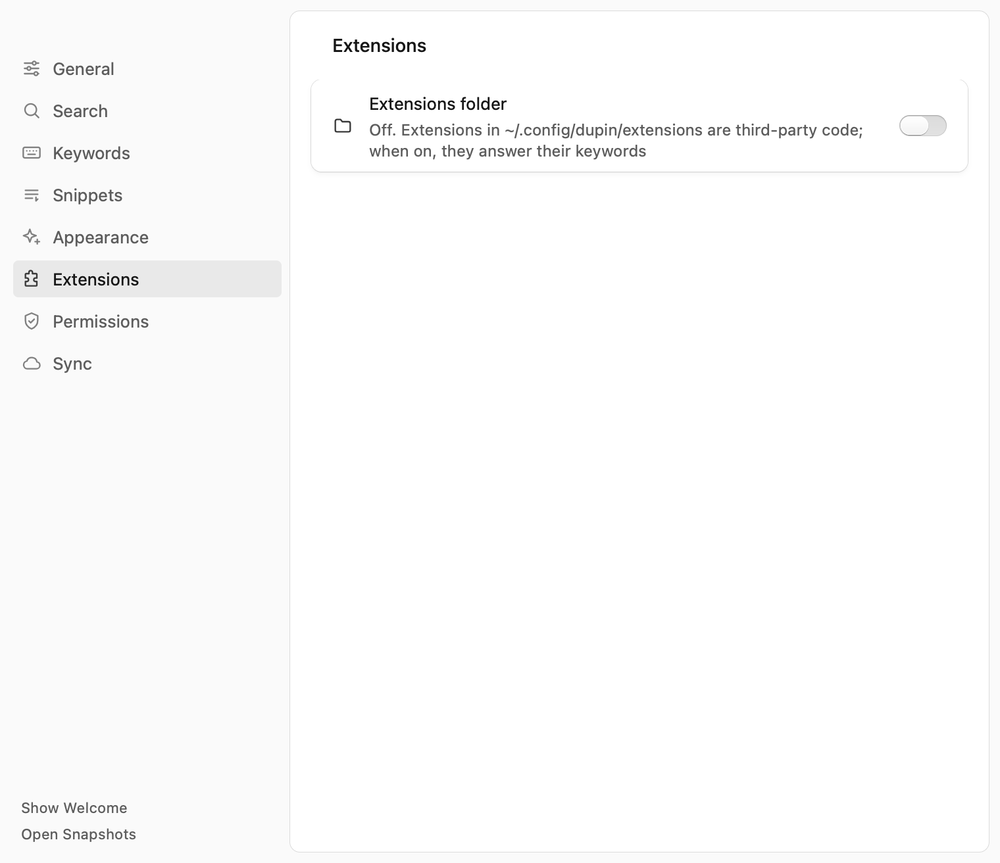

# Extensions

An extension is a JavaScript or TypeScript package that answers one keyword: type the keyword and Space, then a query, and Dupin shows the rows the extension returns. It runs inside Dupin, sandboxed; to drive Dupin from a terminal, a script or an AI agent, use the [command line](./cli.md) or the [MCP server](./mcp.md).

Every search in Dupin is a pipeline, a model Dupin owes to Shougo Matsushita's [unite.vim](https://github.com/Shougo/unite.vim), [denite.nvim](https://github.com/Shougo/denite.nvim) and [ddu.vim](https://github.com/Shougo/ddu.vim) ([Shougoism](https://zenn.dev/shougo/articles/vimconf-2024)): sources produce rows, filters match and order them, and each row's kind gives it actions. The core stays small, and an extension can plug into each stage.

<Pipeline>

Sources produce rows for the query, filters (matchers and sorters) match and order them, and kinds (text, URL, file and app) give each row its actions. An extension can be a source with its own keyword, provide a matcher or sorter (with the `rows:<kind>` and `query` scopes), or add an action to a kind's rows (with `rows:<kind>`); [`[advanced]`](./advanced.md) recomposes the stages.

</Pipeline>

## Open it

Type an extension's keyword and Space in the panel; `?` lists every keyword. Manage extensions in Settings → Extensions, and install or write them with `dupin ext`.

## What you see

- The extension's title on a keyword chip, then its rows, and a selected row's detail when it has one.
- Pages and forms the extension opens above the list.
- **Turn on _Name_?** or **Allow _Name_ to …?** above the rows when it needs your answer.
- In Settings → Extensions: every extension with its keyword, switch, source and scopes, and every skipped folder with the reason.

<picture>
<source media="(prefers-color-scheme: dark)" srcset="../images/extensions/keyword-dark.png" />

</picture>

<picture>
<source media="(prefers-color-scheme: dark)" srcset="../images/extensions/clip-dark.webp" />

</picture>

## What you can do

| Key / action                                                         | What it does                                                               |
| -------------------------------------------------------------------- | -------------------------------------------------------------------------- |
| <kbd>↩</kbd>                                                         | Runs the row's first action.                                               |
| <kbd>⌘↩</kbd>                                                        | Runs the row's alternate action.                                           |
| <kbd>→</kbd> at the end of the input, <kbd>⌘K</kbd> or <kbd>⌃K</kbd> | Lists all of the row's actions.                                            |
| <kbd>Esc</kbd>, or <kbd>⌫</kbd> in an empty field                    | Closes a page the extension opened.                                        |
| **Turn on _Name_?**                                                  | Turns the extension on. It grants nothing.                                 |
| **Allow** / **Deny**                                                 | Answers the request above the rows.                                        |
| **Request Access**                                                   | Asks macOS, once, for the access a request needs.                          |
| Settings → Extensions → **Allow**, **Revoke**, **Delete Data**       | Allows or revokes one scope, or deletes what it stored.                    |
| `dupin ext install`, `update`, `remove`                              | Manage packages; see [Installing and updating](#installing-and-updating).  |
| `dupin ext eject NAME`                                               | Copies a bundled extension to change it.                                   |
| `dupin ext new`, `dev`, `test`                                       | Write and test one; see [A JavaScript extension](#a-javascript-extension). |

Other keys work as everywhere in the panel; see [Keys](../usage.md#keys).

<details>
<summary>More on each action</summary>

| Key / action                                                      | What it does                                                                                                                         |
| ----------------------------------------------------------------- | ------------------------------------------------------------------------------------------------------------------------------------ |
| <kbd>↩</kbd>                                                      | Runs the row's first action: **Open URL**, then **Copy**, then the extension's own actions in order.                                 |
| <kbd>⌘↩</kbd>                                                     | Runs the row's alternate action; a row whose first action pastes, with no alternate, copies instead.                                 |
| <kbd>Esc</kbd>, or <kbd>⌫</kbd> in an empty field                 | Closes a page the extension opened and selects the row it opened from.                                                               |
| **Deny**                                                          | Revokes the scope until you allow it in Settings.                                                                                    |
| **Request Access**                                                | Asks macOS for the access a request needs, such as Calendars or Accessibility.                                                       |
| Settings → Extensions → **Extensions folder**                     | Turns on extensions you install or write; see [Turning them on](#turning-them-on).                                                   |
| Settings → Extensions → an extension's switch                     | Turns that extension on or off.                                                                                                      |
| Settings → Extensions → **Allow**, **Revoke**                     | Allows or revokes one scope. A files or exec scope that doesn't name its file, folder or program is allowed here, where you pick it. |
| `dupin ext install`, `list`, `update`, `remove`, `sync`, `search` | Install and manage packages.                                                                                                         |
| `dupin ext eject NAME`                                            | See [Overriding a built-in](#overriding-a-built-in).                                                                                 |
| `dupin ext new`, `dev`, `check`, `run`, `test`, `render`          | See [Developing and testing extensions](./extension-testing.md).                                                                     |

</details>

<details>
<summary>Keys in a form</summary>

| Key                                               | What it does                                                       |
| ------------------------------------------------- | ------------------------------------------------------------------ |
| <kbd>Tab</kbd> / <kbd>⇧Tab</kbd>                  | Moves to the next or previous field.                               |
| <kbd>↓</kbd> / <kbd>↑</kbd>                       | Moves between fields, except in a multi-line field.                |
| <kbd>Space</kbd>                                  | Toggles a checkbox, or moves a select to its next option.          |
| <kbd>→</kbd> / <kbd>←</kbd>                       | Moves a select to its next or previous option; toggles a checkbox. |
| <kbd>↩</kbd> in a multi-line field                | Starts a new line.                                                 |
| <kbd>⌘↩</kbd>, or <kbd>↩</kbd> in any other field | Submits the form.                                                  |
| <kbd>Esc</kbd>                                    | Cancels and drops what you typed.                                  |

</details>

## Notes

- Any extension but a bundled one uses nothing it [asks for](./extension-permissions.md#asking-for-more) until you turn it on and allow each scope.
- Installing runs nothing from the package, and packages aren't reviewed: install only extensions you trust.
- Extensions run only on macOS, in a sandboxed helper process.

<details>
<summary>More notes</summary>

- Bundled extensions are on from the start, except Running Apps.
- An update that widens what a package asks for asks again.
- Dupin never asks macOS for access on its own.
- A third-party extension answers its keyword once it loads, but uses nothing it asks for until you turn it on, and each scope then needs your consent.
- An update that asks for no more keeps your choices.
- There is no package manager, install script or build. What a package can reach is decided by the [capabilities](./extension-permissions.md) you allow, not by a review.
- Only **Request Access**, or turning on a bundled extension that ships off, asks macOS for access.
- An extension can't take a keyword that a built-in command, a web search or a bundled extension already uses.

</details>

## Configuration

### Turning them on

Switch on **Extensions folder** in Settings → Extensions, or set this in `config.toml`:

```toml
extensions = true # run extensions from the extensions folder beside config.toml
```

| Key          | Default | Meaning                                                 |
| ------------ | ------- | ------------------------------------------------------- |
| `extensions` | `false` | Runs the folders in `extensions/` beside `config.toml`. |

<picture>
<source media="(prefers-color-scheme: dark)" srcset="../images/settings/extensions-dark.png" />

</picture>

<details>
<summary>The folder, reloads and where choices are kept</summary>

`extensions` runs the third-party folders in `extensions/` beside `config.toml`, each answering its own keyword. Dupin then reads `$XDG_CONFIG_HOME/dupin/extensions/` (or `~/.config/dupin/extensions/`); each folder in it holds one extension. Bundled extensions run whether or not this is on.

Adding, editing or removing a folder, or any JavaScript file in it, applies while Dupin runs. Settings → Extensions lists the loaded extensions with their keywords and a switch for each, and every folder it skipped with the reason. An extension from the folder answers its keyword once it loads but can use nothing it asks for until you turn it on; turning it off stops it answering. Your choice is kept in Dupin's [encrypted storage](./storage.md#built-in-namespaces), in the `extension-grants` namespace.

</details>

### Declaring them with Nix

The [Home Manager module](../configuration.md#nix) can declare packages and their grants instead:

```nix
programs.dupin.extensions = [
  { src = pkgs.fetchFromGitHub { /* … */ }; grants = [ "http:https://api.example.com" ]; }
];
```

| Option     | Default             | Meaning                                                     |
| ---------- | ------------------- | ----------------------------------------------------------- |
| `src`      | Required            | The package, linked read-only into the extensions folder.   |
| `name`     | `package.json` name | The folder's name.                                          |
| `grants`   | `[]`                | Scopes allowed ahead of time, for exactly this `src`.       |
| `bindings` | `{}`                | The path a granted `files` or `exec` scope is bound to.     |
| `deny`     | `[]`                | Scopes the package may never be granted, even from Dupin.   |
| `enable`   | `true`              | `false` keeps the package off whatever you choose in Dupin. |

<details>
<summary>A full example, and the options in full</summary>

```nix
programs.dupin = {
  enable = true;
  settings.extensions = true;
  extensions = [
    {
      src = pkgs.fetchFromGitHub {
        owner = "someone";
        repo = "dupin-word-count";
        rev = "0123456789abcdef0123456789abcdef01234567";
        hash = "sha256-…";
      };
      grants = [
        "http:https://api.example.com"
        "files:notes"
      ];
      bindings."files:notes" = "/Users/me/Notes";
      deny = [ "clipboard:read" ];
    }
  ];
};
```

| Option     | Default             | Meaning                                                                                                               |
| ---------- | ------------------- | --------------------------------------------------------------------------------------------------------------------- |
| `src`      | Required            | The package. It links read-only into the extensions folder.                                                           |
| `name`     | `package.json` name | The folder's name. Set it to avoid reading the package while Nix evaluates.                                           |
| `grants`   | `[]`                | Scopes allowed ahead of time, for exactly this `src`. A `files` or `exec` scope also needs its path in `bindings`.    |
| `bindings` | `{}`                | The absolute path a granted `files` or `exec` scope is bound to: the file or folder it reads, or the program it runs. |
| `deny`     | `[]`                | Scopes the package may never be granted, even from Dupin.                                                             |
| `enable`   | `true`              | `false` keeps the package off whatever you choose in Dupin.                                                           |

These packages are pinned by Nix, so they aren't in the [installed extensions list](./extension-distribution.md#the-installed-extensions-list), and `dupin ext update` and `remove` leave them to Home Manager.

</details>

<details>
<summary>The grants file</summary>

Its grants go to `extension-grants.toml` beside `config.toml`, the broker's read-only base, in the broker's own format:

```toml
version = 1

[packages.word-count]
revision = "blake3:…"
enabled = true
grant = ["http:https://api.example.com", "files:notes"]
deny = ["clipboard:read"]
bindings = { "files:notes" = "/Users/me/Notes" }
```

A grant applies only to the `revision` it names: `dupin ext revision DIR` prints it, and Home Manager runs it on `src` when the configuration builds, so changing `src` needs the new revision and nothing in an edited copy is granted. The base applies to each package by its `package.json` name, whatever `name` calls its folder, and two packages of one name fail the build.

</details>

<details>
<summary>How declared grants combine with Dupin's</summary>

Choices made in Dupin, in the `extension-grants` namespace, can take a declared grant away but never widen it, and a denied scope can't be allowed. Dupin reads the base again as soon as it changes, so a denial, `enable = false` or a grant taken away applies at once, but a new grant waits until Dupin restarts. macOS still asks for its own permissions only when you choose Request Access.

</details>

<details>
<summary>Errors in the grants file</summary>

Every scope in `grants`, `deny` and `bindings` must be one the broker can read, or evaluation fails. If Dupin still finds an entry in `extension-grants.toml` it can't read, it sets aside only that package's entry, keeps the package off with every scope denied, and says why in Settings → Extensions; the other entries still apply. Fixing the entry clears the problem, and the package can be turned on again once Dupin restarts.

If the whole file can't be used, because it can't be read or parsed, Settings → Extensions names the file and the error, and until it is fixed no extension gets anything from it or from what bundled extensions ship with: only what you allowed in Dupin applies. Extensions still load and answer whatever needs nothing. Fixing the file restores what bundled extensions ship with at once; its own grants wait until Dupin restarts. A missing file simply declares nothing.

</details>

#### Bundled extensions with Nix

`bundledExtensions` turns the [bundled extensions](#bundled-extensions) on or off, or denies scopes, by their `package.json` name:

```nix
programs.dupin.bundledExtensions = {
  running-apps.enable = true;
  calendar.deny = [ "calendar" ];
};
```

<details>
<summary>Options, and how it is written and checked</summary>

```nix
programs.dupin.bundledExtensions = {
  running-apps.enable = true;
  calendar.deny = [ "calendar" ];
  clipboard-history.enable = false;
};
```

| Option   | Default | Meaning                                                                                                                                                                                                 |
| -------- | ------- | ------------------------------------------------------------------------------------------------------------------------------------------------------------------------------------------------------- |
| `enable` | `null`  | Leaves the switch to Dupin. `true` turns the package on, Running Apps included, though Settings can still turn it off. `false` keeps it off, and a built-in command it answers says it isn't available. |
| `deny`   | `[]`    | Scopes the package may never use, though it ships with them granted, such as `calendar`, `clipboard:watch` or `apps:control`.                                                                           |

They go to the same `extension-grants.toml`, under `bundled:<name>` and without a revision, since a bundled package only ever runs as the sealed copy that shipped:

```toml
[packages."bundled:running-apps"]
enabled = true

[packages."bundled:calendar"]
deny = ["calendar"]
```

Dupin grants what a bundled package declares in advance, and no bundled package declares files or programs, which would be bound to a path. A name the configured `package` doesn't bundle fails evaluation, and so does a denial of a scope that package doesn't declare; both messages list what it does bundle or declare. A built-in command still needs its own setting, such as `calendar.enabled`, to register it. A changed copy in the extensions folder is a package of its own, so none of this applies to it.

</details>

## Bundled extensions

Some extensions ship inside Dupin and run whether or not the extensions folder is on, each with a switch in Settings → Extensions.

| Extension                         | Keyword | What it does                                                                                        |
| --------------------------------- | ------- | --------------------------------------------------------------------------------------------------- |
| **Dupin**                         | `help`  | Searches Dupin's documentation, issues, source and website.                                         |
| [Emoji & Symbols](./emoji.md)     | `emoji` | Picks an emoji or symbol by its English or Japanese name.                                           |
| [Running Apps](./running-apps.md) | `quit`  | Hides, quits and force quits running apps, and adds those actions to app rows. Off until turned on. |

<details>
<summary>Built-in features as packages</summary>

[Calculator](./calculator.md), [Calendar search](./calendar.md), [Clipboard history](./clipboard.md), [Dictionary](./dictionary.md) and [Snippets](./snippets.md) are bundled extensions too. Each keeps its own settings and keywords, and Settings → Extensions lists it as a built-in command. Its package's `keyword` is the one its built-in answers by default, and a copy's own `keyword` is ignored. **Dupin** (`help`) takes a word typed after its keyword. Web Search lists the web searches that the main search reaches by their alias. To change any bundled extension, [copy it](#overriding-a-built-in) into the extensions folder.

Calculator answers the main search rather than a keyword, so its package declares none: Dupin hands its package only what you type there that has a digit in it, and only while the package holds `query`. A feature's Settings rows reach its package as the package's [preferences](./extension-manifest.md#preferences), and a package that watches on a feature's behalf watches only while the feature is on. One that reads config.toml, as Snippets does, gets those settings in its preferences too, and only the copy that shipped gets them: once an ejected copy is changed, it is third-party and gets none.

</details>

<details>
<summary>Where they live</summary>

| Where                        | What                                                                                                                                                                                                                                  |
| ---------------------------- | ------------------------------------------------------------------------------------------------------------------------------------------------------------------------------------------------------------------------------------- |
| `Dupin.app`                  | `Contents/Resources/extensions/<name>/`, read-only and inside the app's code signature.                                                                                                                                               |
| A build from the source tree | The repository's [`extensions/`](../../extensions), so `cargo run` and headless renders load them without packaging.                                                                                                                  |
| The repository               | Each package is TypeScript that Dupin runs as written, or JavaScript with `// @ts-check`, typed by [`sdk/dupin.d.ts`](../../sdk/dupin.d.ts). `checks.extensions-typecheck` runs `tsc --noEmit` over `extensions/tsconfig.json` in CI. |

Each build of Dupin records a hash of every file in each bundled package folder, and loads a folder there only while its files still match: a package added to the folder, or a file changed in it, stays off and is listed as skipped. A build from the source tree records the repository's `extensions/` as it was when it was built, so rebuild after editing one.

</details>

<details>
<summary>Grants and keywords</summary>

A bundled extension is on until you turn it off in Settings → Extensions, except Running Apps, which stays off, answering nothing, until you turn it on there or [with Nix](#declaring-them-with-nix). Dupin knows it by its `name` and a hash of its `package.json` and modules: while it runs exactly the copy that shipped, the [capability broker](../capability-broker.md) grants what it declares in advance, and macOS still asks for its own permissions on first use ([Permissions](./permissions.md#extensions)). The broker keeps its grants and its switch under `bundled:<name>`, apart from any package in the extensions folder.

A user extension can't take a bundled extension's keyword, as it can't take a built-in command's: `dupin ext install` refuses it, and Settings lists one already in the folder as skipped and marks its row as not answering. Extensions from the folder load only once the bundled ones have been read, so one never holds a bundled keyword for a moment at launch.

`dupin ext install` refuses a package named like a bundled one, and a package installed before a later Dupin bundled its name stays off, listed in Settings with the reason, until you remove it with `dupin ext remove`.

</details>

### Overriding a built-in

`dupin ext eject NAME` copies a bundled extension to `extensions/NAME`, where your copy answers in its place while the extensions folder is on.

```sh
dupin ext eject dupin
```

| The copy is…      | It has                                                     |
| ----------------- | ---------------------------------------------------------- |
| Unchanged         | The bundled grants and switch.                             |
| Changed by a byte | Its own grants and switch: it is off until you turn it on. |
| Deleted           | The bundled one comes back with its grants and switch.     |

<details>
<summary>How ejecting and copies work</summary>

`dupin ext eject NAME` copies the bundled package called `NAME` with files you can edit, and refuses if that folder exists. A package there with the bundled one's `name` answers in its place: under its keyword and in the main search, or, for a built-in command, under that command's keywords. Every bundled extension follows the same rules, including one that answers a built-in command:

| The copy is…      | It has                                                                                                                                                                     |
| ----------------- | -------------------------------------------------------------------------------------------------------------------------------------------------------------------------- |
| Unchanged         | The bundled grants and switch. Settings → Extensions marks it as your unchanged copy.                                                                                      |
| Changed by a byte | Its own grants and switch, as any package in the extensions folder: it answers, but uses nothing it declares until you turn it on, and each capability needs your consent. |
| Deleted           | The bundled one comes back with its grants and switch as you left them. Turning the extensions folder off does the same.                                                   |

Eject again to start afresh: `dupin ext eject` forgets what an earlier changed copy of the same name was allowed, turned on or stored.

</details>

<details>
<summary>Rules for a changed copy</summary>

- Once a byte of its `package.json` or a module differs, none of the bundled grants, consents or choices apply: it has the grants and switch of your own package of that name. A copy you eject and change answers what you type but can use nothing it declares until you turn it on, and each capability then needs your consent. Editing it again is another revision of the same package, so it keeps its switch and every grant its declaration doesn't widen. Settings → Extensions marks it as replacing the bundled one.
- **Ejecting starts afresh.** `dupin ext eject` forgets what an earlier changed copy of the same name was allowed, turned on or stored, as `dupin ext install` does for a name installed afresh, so a new copy you change waits to be turned on again. If it can't forget them, it removes the copy and says why.
- **Deleting a copy doesn't forget them**, so a changed folder you put back by hand, without `dupin ext eject`, is that earlier copy edited: it is on if the earlier one was, keeps the grants its declaration doesn't widen and reads what the earlier one stored. Eject to start afresh, or turn it off and revoke its grants in Settings → Extensions.

</details>

<details>
<summary>A built-in command's copy</summary>

A built-in command keeps its setting and keywords. The copy answers only while the command's own setting is on, under the keywords that setting gives, and the `keyword` in its `package.json` is ignored. A built-in command has two switches, both of which must be on: its setting registers the command, and the package's switch in Settings → Extensions lets the package run. Turning the package off leaves the command saying it isn't available; turning a copy off doesn't bring the bundled one back.

Settings → Extensions lists every bundled extension, built-in commands' included, with where it comes from (bundled, your unchanged copy, or a changed copy that replaces it), its switch and its grants, so each can be adjusted there. A built-in command's row says it answers that command in place of a keyword.

The `dupin` crate's `extensions::overrides` test takes each package in `extensions/` through ejecting, answering, editing, its grants, turning the copy and the extensions folder off, deleting the copy, putting a changed one back by hand, an eject that can't forget the earlier copy's choices and one that does, and fails for a package added there without a case of its own.

</details>

## Example extensions

The repository's [`examples/extensions`](../../examples/extensions) holds packages that don't ship with Dupin. Each one is a working extension that you can install as it is or copy, and CI replays its fixtures with `dupin ext test`, so a change to the SDK can't break one unnoticed.

| Extension                                   | Keyword  | What it does                                             |
| ------------------------------------------- | -------- | -------------------------------------------------------- |
| [Processes](./processes.md)                 | `proc`   | Lists running processes, and stops one.                  |
| [Ports](./ports.md)                         | `port`   | Lists listening ports and what holds each.               |
| [Repositories](./repo.md)                   | `repo`   | Opens your Git repositories in an editor or terminal.    |
| [Window Management](./window-management.md) | `window` | Moves and resizes the focused window.                    |
| Notes                                       | `note`   | Keeps notes in a list, with a form to add and edit them. |
| Word Count                                  | `wc`     | Counts the words typed after its keyword.                |

To install one, clone the repository and install the package's folder, then turn on the extensions folder and the package in Settings → Extensions:

```sh
git clone https://github.com/x-ryoppippi/dupin
dupin ext install ./dupin/examples/extensions/proc
```

An installed example is a package like any other. It gets nothing in advance, and each scope waits for you to allow it. `dupin ext update proc` copies the folder again.

<details>
<summary>Processes, Ports, Repositories and Window Management used to be bundled</summary>

Dupin bundles a package only when someone coming from Alfred or Raycast would expect it with an empty configuration, when it is used in one shot, and when bundling gives it something that installing can't ([the bundling rule](../design/extension-platform.md#built-ins-as-bundled-extensions)). These four list processes, ports or repositories that you watch, or rely on running programs and reading folders, so they moved to the examples.

If you had one turned on, Dupin ignores its old switch and grants without a word: they were kept under `bundled:<name>`, and no package has that name any more. Install the example to use it again; you turn it on and allow its scopes afresh. `programs.dupin.bundledExtensions` no longer accepts these names, nor `grants` and `bindings`, which only Repositories used. Declare the example under `programs.dupin.extensions` instead.

</details>

## Installing and updating

`dupin ext install` fetches a package from GitHub, any Git URL or a folder, and places it in the extensions folder; it runs once the extensions folder is [on](#turning-them-on).

```sh
dupin ext install github:someone/dupin-word-count   # the newest version tag
```

| Command                    | Does                                                                 |
| -------------------------- | -------------------------------------------------------------------- |
| `dupin ext search [QUERY]` | Lists GitHub repositories with the `dupin-extension` topic.          |
| `dupin ext list`           | Lists installed packages, their state and granted scopes.            |
| `dupin ext update [NAME]`  | Moves one package, or all, to the newest version.                    |
| `dupin ext remove NAME`    | Deletes the package, its grants and its stored data.                 |
| `dupin ext sync`           | Reinstalls every missing or modified package from its locked commit. |

[Distributing extensions](./extension-distribution.md) has how sources and refs resolve, what an install checks, and the [installed extensions list](./extension-distribution.md#the-installed-extensions-list).

<details>
<summary>Sources, and the commands in full</summary>

The package is named after `name` in its `package.json`.

```sh
dupin ext install github:someone/dupin-word-count          # the newest version tag
dupin ext install github:someone/dupin-word-count@v1.2.0   # a tag or a branch
dupin ext install github:someone/dupin-word-count@0123456789abcdef0123456789abcdef01234567
dupin ext install https://git.example.com/me/notes.git@main # an https://, ssh:// or file:// URL, or user@host:path
dupin ext install ./word-count                              # a folder, copied as it is now
```

| Command                    | Does                                                                                                                                                             |
| -------------------------- | ---------------------------------------------------------------------------------------------------------------------------------------------------------------- |
| `dupin ext search [QUERY]` | Lists GitHub repositories with the `dupin-extension` topic; see [Finding packages](./extension-distribution.md#finding-packages).                                |
| `dupin ext list`           | Lists installed packages with their source, commit, state (installed, missing or modified) and the scopes granted for the installed revision.                    |
| `dupin ext update [NAME]`  | Moves one package, or all, to the newest version tag (or the default branch), or copies a folder source again, and shows the capability scopes it adds or drops. |
| `dupin ext remove NAME`    | Deletes the package's folder and its entry, with its grants and stored data.                                                                                     |
| `dupin ext sync`           | Reinstalls every package that is missing or modified from its locked commit, and checks it has the locked content hash.                                          |

Each takes `--json`.

</details>

## A JavaScript extension

Two files in a folder of `~/.config/dupin/extensions/` make a complete extension:

```json
{
	"name": "word-count",
	"version": "0.1.0",
	"dupin": { "title": "Word Count", "keyword": "wc" }
}
```

```js
export function search(query) {
	const input = query.trim();
	if (!input) return [];
	const count = input.split(/\s+/u).length;
	return [{ title: `${count} words`, text: String(count) }];
}
```

Type `wc two words` to see **2 words**. Enter copies `2`. To start your own, run `dupin ext new word-count --ts`, then `dupin ext dev word-count` to keep a live copy while you edit. To [use npm packages](./extension-distribution.md#building-a-bundle), start with `--bundle` instead and run `bun install` inside `word-count` before `dupin ext dev`.

Reference: [manifest](./extension-manifest.md), [API](./extension-api.md), [capabilities](./extension-permissions.md), [developing and testing](./extension-testing.md), [distributing](./extension-distribution.md).

<details>
<summary>The folder and the commands</summary>

```text
~/.config/dupin/extensions/word-count/
├── package.json
└── main.js
```

`package.json` holds the manifest and `main.js` the module. [`examples/extensions/word-count-js`](../../examples/extensions/word-count-js) holds these two files.

```sh
dupin ext new word-count --ts   # package.json, src/main.ts, dupin.d.ts and a fixture
dupin ext dev word-count        # keeps extensions/word-count current while you edit
dupin ext run word-count --query 'two words'
```

The reference pages cover: the manifest's icons, preferences, modules and TypeScript without a build; the API's catalogues, details, images and limits; capabilities for HTTP, files, programs, storage, clipboard, calendar, windows and more; `dupin ext check`, `run`, `test` and `render`; and building a bundle, publishing, how installs resolve and check a package, and the installed extensions list.

</details>

## Testing and rendering

`dupin ext test` replays the fixtures in a package's `fixtures/` folder against stated expectations, with host services answered from the fixture instead of this Mac, and `dupin ext render` renders the panel a fixture produces as a PNG:

```sh
dupin ext test greeter
dupin ext render greeter greeter/fixtures/search.json search.png
```

[Developing and testing extensions](./extension-testing.md#testing-and-rendering) has the commands, the [fixture format](./extension-testing.md#fixtures) and the [MCP tools](./mcp.md#extension-tools) that run them for an agent.
