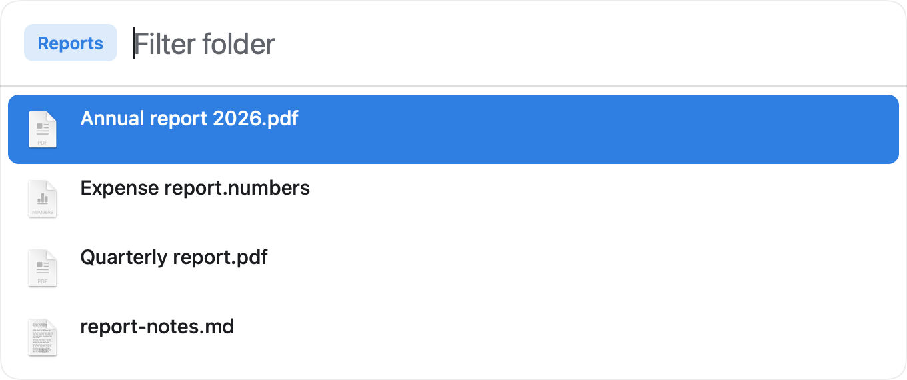

# Folder browsing

Tab on a folder, or its Browse action, lists the folder in the panel, with its name in the chip: folders first, then by name. Type to filter the entries fuzzily; hidden entries appear when the filter starts with `.`. Tab enters a subfolder and ⌫ on an empty filter returns to the parent. Leaving the first folder restores the search, its query and selection. Listed entries have the same actions as search results.

<picture>
<source media="(prefers-color-scheme: dark)" srcset="../images/folder-browsing/browse-dark.png" />

</picture>

[File actions](./file-actions.md)
