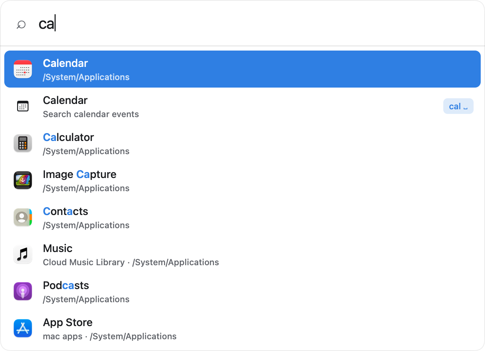
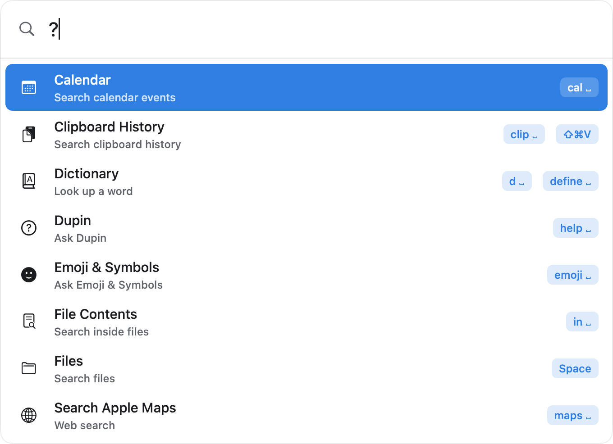
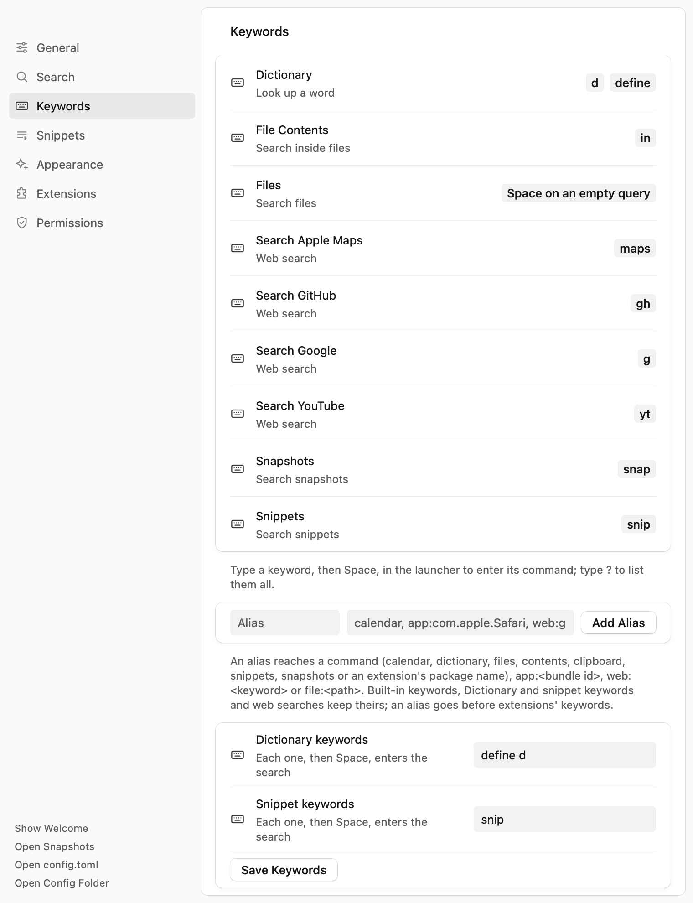

# Keywords

A keyword typed at the start of the main search, then Space, enters a command's own search.

## Open it

Type a keyword and <kbd>Space</kbd>, or `?` alone to list them all.

| Keyword                                | Enters                                                         |
| -------------------------------------- | -------------------------------------------------------------- |
| `cal`                                  | [Calendar](./calendar.md)                                      |
| `define`, `d`                          | [Dictionary](./dictionary.md)                                  |
| `in`                                   | [File contents](./files.md)                                    |
| `clip`                                 | [Clipboard history](./clipboard.md)                            |
| `snip`                                 | [Snippets](./snippets.md)                                      |
| `emoji`                                | [Emoji & Symbols](./emoji.md)                                  |
| `snap`                                 | [Snapshots](./snapshots.md)                                    |
| `help`                                 | Dupin's own links                                              |
| An extension's keyword                 | That [extension](./extensions.md)                              |
| `g`, `gh` and other web search aliases | A [web search](./web-searches.md), with the query that follows |
| <kbd>Space</kbd> on an empty query     | [Files](./files.md)                                            |

## What you see

- While what you type is a keyword, or the start of one, the command it reaches as a row, with the keyword and `␣` (Space) as a tag at its end, such as **Calendar** `cal ␣`.
- A command with a [shortcut](#shortcuts) shows it as a tag after its keywords, such as **Clipboard** `clip ␣` `⇧⌘V`.
- The rows a keyword or a typed alias reaches directly, such as a web search's, show it as a tag too.
- With `?`, every command, web search and the files search with their keywords and aliases, each with the command's icon, which its chip shows too once it is entered.

<picture>
<source media="(prefers-color-scheme: dark)" srcset="../images/keywords/typing-dark.png" />

</picture>

<picture>
<source media="(prefers-color-scheme: dark)" srcset="../images/keywords/list-dark.png" />

</picture>

## What you can do

| Key / action                                  | What it does                                                                                                               |
| --------------------------------------------- | -------------------------------------------------------------------------------------------------------------------------- |
| Keyword, then <kbd>Space</kbd>                | Enter the command                                                                                                          |
| <kbd>↩</kbd> or <kbd>⇥</kbd> on a keyword row | Enter the command exactly as typing the keyword and Space does; for a web search, leave the alias and a space in the query |
| `?`, then choose a row                        | Enter that command                                                                                                         |

Other keys: [Keys](../usage.md#keys).

## Notes

- Keywords are case-sensitive when typed with Space; the rows match them in any case, and <kbd>↩</kbd> or <kbd>⇥</kbd> types them as configured.
- An empty query shows what it always did.
- Snippets, with no snippet at all, is neither suggested nor listed, though `snip` still enters it to add the first one ([Snippets](./snippets.md#adding-and-editing)).

<details>
<summary>Ranking of keyword rows</summary>

The row never pushes the best match down for a short query:

- An exact keyword of three or more characters, such as `cal` or `define`, leads the results.
- A shorter exact keyword, such as `d` or `in`, leads only when no other command's keyword starts with it; `g`, which `gh` also starts, does not.
- The start of a keyword, such as `ca` or `e`, follows the first result, with up to three commands, exact and shortest keywords first.
- A web search's own alias already shows its search first, so it adds no second row.

A row's icon is a bundled extension's or a package's own [`dupin.icon`](./extension-manifest.md#icons).

</details>

## Configuration

### Aliases

`[aliases]` in config.toml maps a shorthand you type in the main search to what it reaches:

```toml
[aliases]
c = "calendar" # c, then Space, enters Calendar search, as cal does
lookup = "dictionary"
wc = "word-count" # an extension, by its package name
ff = "app:org.mozilla.firefox" # typing ff shows Firefox first
goo = "web:g" # goo rust searches Google, as g rust does
dl = "file:~/Downloads" # typing dl shows the Downloads folder first
```

| Target            | Reaches                                                                                                                                                                             |
| ----------------- | ----------------------------------------------------------------------------------------------------------------------------------------------------------------------------------- |
| A command's name  | `files`, `contents`, `calendar`, `clipboard`, `dictionary`, `snippets`, `snapshots`, or an extension's package name. The alias, then Space, enters the command as its keyword does. |
| `app:<bundle id>` | An installed app, such as `app:com.apple.Safari`. Typing the alias shows the app as the first result; ↩ opens it.                                                                   |
| `web:<keyword>`   | A [web search](./web-searches.md) by its keyword. The alias takes a query as that keyword does, and is listed beside it.                                                            |
| `file:<path>`     | A file or folder by an absolute or `~/` path. Typing the alias shows it as the first result; ↩ opens it.                                                                            |

`dictionary_keywords` and `snippet_keywords` keep working as before, beside any alias for the same command. With Home Manager, set aliases in `programs.dupin.settings.aliases`.

<details>
<summary>Alias rules</summary>

An alias is 1 to 32 ASCII letters, digits, underscores or hyphens, and config.toml takes up to 64. A malformed alias or target makes config.toml invalid, naming the entry and what is wrong, and a reload keeps the previous configuration.

An alias that is well formed but reaches nothing is left out with a notice, and Settings → Keywords says why beside it: its keyword is taken, its command's feature is off, its extension isn't installed or on, no web search answers to its keyword, or its app or file isn't there.

</details>

### Shortcuts

A global shortcut can open a command from any app, with the panel already in that command; pressing it again hides the panel. Record one in [Settings → Keywords](#settings), or write a `target = "dupin"` binding that names the command as an alias does, as [Hotkeys](./hotkeys.md#configuration) describes:

```toml
[bindings."cmd+shift+v"]
target = "dupin"
command = "clipboard"
```

### Who gets a keyword

Every keyword reaches one command, web search, app or file. Dupin registers them in this order, and a keyword already taken is skipped with a notice that names the setting to fix:

1. Built-in commands: `in`, and `cal` and `clip` while Calendar search and clipboard history are on.
2. `dictionary_keywords` and `snippet_keywords` in config.toml.
3. `snap` for snapshots.
4. Web search aliases, from `web_searches` or the defaults `g`, `gh`, `maps` and `yt`.
5. [Aliases](#aliases) in `[aliases]`.
6. Extension keywords, bundled extensions first, then the extensions folder in order.

So an alias never takes a keyword a built-in, `dictionary_keywords`, `snippet_keywords` or a web search already has, and an extension's keyword never takes an alias. `dupin ext install` refuses a package whose keyword one of these already holds.

## Settings

Settings → Keywords lists every command, web search, app and file a keyword reaches with its keywords, the aliases among them drawn quieter, and each extension with its keyword.

<picture>
<source media="(prefers-color-scheme: dark)" srcset="../images/settings/keywords-dark.png" />

</picture>

| Key / action                                       | What it does                                                           |
| -------------------------------------------------- | ---------------------------------------------------------------------- |
| Click a command's shortcut recorder, press a chord | Save it to `[bindings]`                                                |
| <kbd>⌫</kbd> while recording, or **Clear**         | Remove the shortcut                                                    |
| <kbd>Esc</kbd> while recording                     | Cancel                                                                 |
| **Remove** beside an alias                         | Delete the alias                                                       |
| The fields below the aliases                       | Add an alias                                                           |
| The last card                                      | Edit `dictionary_keywords` and `snippet_keywords`, separated by spaces |

<details>
<summary>Locked and refused shortcuts</summary>

- Each command a binding can name has a shortcut recorder below its keywords.
- A chord the panel, the selection hotkey, another binding or macOS already uses is refused with what holds it.
- When `bindings` is set in a read-only config.toml, such as one Home Manager writes, the recorders are locked and say so; otherwise a read-only config.toml's other keys stay locked and the shortcut is saved with Dupin's own settings, as [Configuration](../configuration.md) describes.
- Each alias shows what it reaches and, if it is left out, why.
- A key set in a read-only config.toml, such as one Home Manager writes, is shown locked.

</details>
