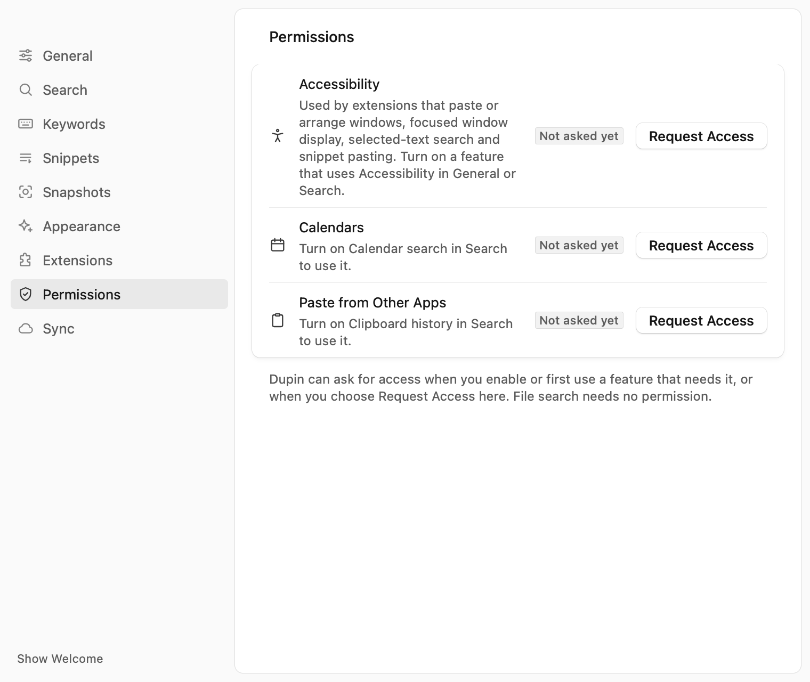

# Permissions

Settings → Permissions shows which features use each macOS grant, what macOS has allowed, and lets you ask for or manage each one.

## Open it

Open **Settings → Permissions** (<kbd>⌘,</kbd> in the panel). An extension's own grants are in **Settings → Extensions**.

## What you see

- One row each for Accessibility, Calendars and Paste from Other Apps.
- Under each, the features and installed extensions that use it, with extensions you haven't allowed marked.
- Its status, such as **Allowed**, **Not asked yet**, **Denied**, **Restricted** or **Add only**.

<picture>
<source media="(prefers-color-scheme: dark)" srcset="../images/settings/permissions-dark.png" />

</picture>

## What you can do

| Key / action                                                                                     | What it does                                                             |
| ------------------------------------------------------------------------------------------------ | ------------------------------------------------------------------------ |
| **Request Access**                                                                               | Asks macOS for a grant for the first time, even while its feature is off |
| **Open System Settings**                                                                         | Manages an existing decision in System Settings                          |
| Turn on **Calendar search**                                                                      | Asks for Calendars access when needed                                    |
| Turn on **Paste snippets**                                                                       | Asks for Accessibility when needed                                       |
| Record a **Selection hotkey** for the first time                                                 | Asks for Accessibility when needed                                       |
| Turn on the bundled **Window Management** in Settings → Extensions                               | Asks for Accessibility when needed                                       |
| **Allow**, **Deny** above an extension's results; **Allow**, **Revoke** in Settings → Extensions | Decides what an [extension](#extensions) may use                         |

## Notes

- Starting Dupin, opening Settings and reloading configuration only check access; they never ask.
- A feature enabled through `config.toml` can prompt on first use.
- File search uses the Spotlight index and needs no grant.
- macOS access for Dupin never lets an extension use it; each extension also needs your own grant.

When the status refreshes

Dupin refreshes the status when the Calendar request finishes and when Settings regains focus. While a request is open the row shows **Waiting for macOS**; it can also show **Request incomplete**, **Not allowed**, **Unknown** or **Unavailable**.

## Extensions

macOS grants access to Dupin as a whole, but that never lets an extension use it. Each extension also needs your own grant for each thing it declares, such as one website, a folder you pick or reading the clipboard. Dupin keeps these grants itself, separate from macOS, in its [encrypted storage](./storage.md#built-in-namespaces).

- An extension you add starts off, with nothing granted.
- When it asks for something you haven't decided on, the panel shows **Allow _Name_ to …?** with **Allow** and **Deny** above its results.
- Turning an extension off or revoking a grant takes effect at once.
- A grant covers the exact version you approved; an update that asks for more asks you again.

How extension grants work

- An extension you add starts off, with nothing granted. When it first asks for something, the panel offers to turn it on; turning it on grants nothing.
- When it asks for something you haven't decided on, its request fails and the panel shows **Allow _Name_ to …?** with **Allow** and **Deny** above its results. Settings → Extensions lists the same requests, and each extension's declared scopes with whether each is allowed, with **Allow**, **Revoke** and, for those that need macOS access, **Request Access**. A file, folder or program is picked there. Allowing never runs again what was refused; use the extension again.
- Dupin never shows a prompt of its own: not at startup, on opening Settings, on reload or for background work. A request row appears only beside the results of the extension that asked, and only your choice of Allow, Deny or Request Access changes anything.
- Only an action you choose lets an extension send anything but GET or HEAD, run a program or script, or read or write the clipboard. The exception is a program you allowed to run in the background, whose request says so. Dupin attaches that to the call; the extension can't claim it.
- Turning an extension off or revoking a grant takes effect at once: an extension turned off stops answering its keyword, its results in flight are dropped, its clipboard watch stops and allowing again doesn't bring them back.
- A grant covers the exact version you approved. An update that asks for more asks you again; anything it no longer needs is dropped.
- Grants are kept in Dupin's [encrypted storage](./storage.md#built-in-namespaces), never in the clear. Home Manager can declare grants and denials ahead of time in `extension-grants.toml` beside `config.toml`; a choice made in Dupin can take a declared grant away but never widen it. [Extensions](./extensions.md#declaring-them-with-nix) has the format.
- [Extensions that ship with Dupin](./extensions.md#bundled-extensions) are on by default with their own grants in place, but still need macOS access. Window Management is the exception: it stays off until you turn it on in Settings → Extensions, and then holds its grants as the others do. A copy you change, such as one `dupin ext eject` made, is treated like any other extension and loses those grants.

Extensions and macOS access

An extension that reads calendar events needs Calendars access, one that reads or watches the clipboard needs Dupin allowed to paste from other apps, and one that pastes or reads and moves windows needs Accessibility. Until macOS allows it, the extension's request fails and asks for it with **Request Access**. An extension allowed to see the file you were viewing ([`context:document`](./extension-permissions.md#context)) uses Accessibility only once another feature has it, and never asks for it.

Besides **Request Access**, only turning on a bundled extension that ships off, such as Window Management, asks macOS, and only for what its grants need, since its switch is the feature's switch. Turning on any other extension, Calendar or Clipboard history among them, never asks; their features' own settings do. Turning on the extensions folder itself never asks macOS for any of them.

Settings → Permissions lists extensions among the uses of Accessibility, Calendars and Paste from Other Apps, and names each installed extension that declares them, marked when you haven't allowed it. [Capability broker](../capability-broker.md) describes the rules.

## Paste from Other Apps

The **Paste from Other Apps** row is used by clipboard history and by extensions that read the clipboard. Clipboard history records in the background only while it is **Always Allow**. **Request Access** on this row reads the clipboard once so macOS asks; turning clipboard history on only checks the policy.

macOS versions and the pasteboard policy

On macOS versions that report the pasteboard access policy, clipboard history records in the background only while it is **Always Allow**; earlier versions have no policy, and the row shows Allowed. Request Access reads the clipboard once so macOS asks and lists Dupin in System Settings; turning clipboard history on only checks the policy. If macOS is set to ask or deny, Open System Settings goes to Privacy & Security, where you can always allow Dupin to paste from other apps.

