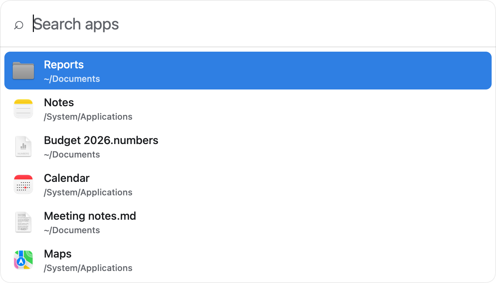

# Recent items

With an empty query, Dupin shows up to ten apps and files from your usage history,
ranked by how recently and how often you used them. These rows have the regular
app and file actions. Turn off **Show recent items** in Settings → Search to keep
the panel empty before typing.

<picture>
<source media="(prefers-color-scheme: dark)" srcset="../images/recent-items/recent-dark.png" />

</picture>

## Configuration

Set `show_recent = false` or turn off **Show recent items** in Settings → Search to keep the launcher empty before typing.

```toml
show_recent = true # show recently and frequently used apps and files before typing
```
