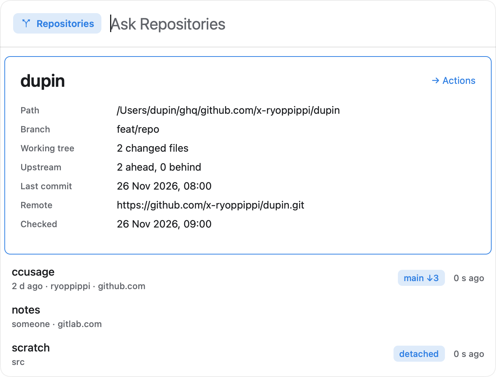
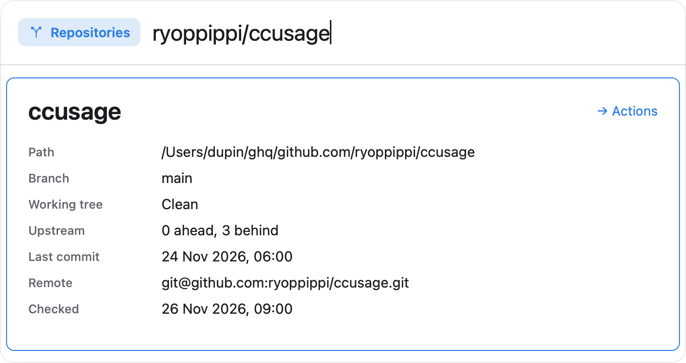

# Repositories

Dupin lists the Git repositories on your Mac and opens one in your editor, your terminal, Finder or its page on the web.

## Open it

Switch on **Repositories** in Settings → Extensions, allow the folders and programs it asks for, then type `repo` <kbd>Space</kbd> and part of a repository's name, such as `ccusage` or `ryoppippi/ccusage`.

> [!TIP]
> Used to `ghq`? Add an [alias](./keywords.md#aliases), and `ghq` <kbd>Space</kbd> opens it as `repo` does:
>
> ```toml
> [aliases]
> ghq = "repo"
> ```

## What you see

- Every repository `ghq list` prints and every folder holding `.git` in `~/ghq`, `~/src`, `~/Developer` and `~/Projects`, each once, by name, with its owner and host, such as `ryoppippi · github.com`.
- Those with a known last commit first, newest first, with how long ago it was; the rest by name.
- For a repository whose Git status Dupin has read: its branch, how far it is ahead of or behind its upstream, how many files are changed and how long ago Dupin read it, such as `main ↓3` and `2 min ago`.
- For the selected row: its path, branch, working tree, upstream, last commit, remote and when Dupin last read it.

<picture>
<source media="(prefers-color-scheme: dark)" srcset="../images/repo/list-dark.png" />

</picture>

<picture>
<source media="(prefers-color-scheme: dark)" srcset="../images/repo/search-dark.png" />

</picture>

## What you can do

| Key / action                                                   | What it does                                                                         |
| -------------------------------------------------------------- | ------------------------------------------------------------------------------------ |
| <kbd>↩</kbd>                                                   | **Open in Editor**: open the repository in the editor you chose, and close the panel |
| <kbd>⌘↩</kbd>                                                  | **Open in Terminal**: open it in the terminal you chose                              |
| <kbd>→</kbd>, <kbd>⌘K</kbd>, <kbd>⌃K</kbd> or the Actions link | Show its other actions                                                               |
| **Reveal in Finder**                                           | Show the folder in Finder                                                            |
| **Open on GitHub**                                             | Open the repository's page, from its `origin` remote, on GitHub or the host it is on |
| **Copy Path**                                                  | Copy the folder's path                                                               |
| **Copy Remote URL**                                            | Copy `origin`'s URL, without any user name or token it holds                         |

Other keys: [Keys](../usage.md#keys).

## Notes

- Off by default.
- Typing never runs Git or a program: Dupin holds the list and matches it itself, and Repositories lists it again every five minutes or when you change its settings.
- Each time it lists, it reads the Git status of a few repositories, those never read first and then those read longest ago, so a long list fills in over a few minutes rather than all at once.
- A folder that holds `.git` is a repository, and Dupin looks no deeper inside it; it skips folders whose names start with `.`, `node_modules`, `Library` and `vendor`.
- A folder in the list that this Mac doesn't have is skipped without asking you about it.
- The editor or terminal opens the folder as it does one dropped on its icon. If it isn't installed, a notice says so.

## Configuration

Repositories is a [bundled extension](./extensions.md#bundled-extensions) called `repo`. Its switch and its settings are in Settings → Extensions; it has no `config.toml` key.

| Setting                                           | Default            | Meaning                                                                                    |
| ------------------------------------------------- | ------------------ | ------------------------------------------------------------------------------------------ |
| Open in editor                                    | Visual Studio Code | Visual Studio Code, Cursor, Zed, Sublime Text, Nova, Xcode or Finder, by bundle identifier |
| Open in terminal                                  | Terminal           | Terminal, Ghostty, iTerm or WezTerm, by bundle identifier                                  |
| List what ghq lists                               | On                 | Asks ghq for its repositories                                                              |
| Look in ~/ghq, ~/src, ~/Developer, ~/Projects     | On                 | Looks for repositories in that folder                                                      |
| Folders deep to look                              | 3                  | How many folders below each one to look, 1 to 4; `~/ghq/github.com/owner/name` is three    |
| Repositories whose Git status is read per refresh | 12                 | 0 to 32; 0 never runs Git                                                                  |

<details>
<summary>Extension scopes</summary>

Each is allowed on its own, in the panel or in Settings → Extensions, and revoking one leaves the rest working: without ghq, Repositories looks in the folders; without the folders, it lists what ghq lists; without Git, it lists names alone.

| Scope                                                         | Lets it                                                                                                                                |
| ------------------------------------------------------------- | -------------------------------------------------------------------------------------------------------------------------------------- |
| `files:ghq`, `files:src`, `files:developer`, `files:projects` | List `~/ghq`, `~/src`, `~/Developer` or `~/Projects` and the folders inside, to find `.git`; it reads no file                          |
| `exec:ghq-list`                                               | Run `ghq list -p`, with the ghq you pick in Settings, such as `/opt/homebrew/bin/ghq` or `~/.nix-profile/bin/ghq`, even while you type |
| `exec:git-status`                                             | Run `/usr/bin/git --no-optional-locks -c core.fsmonitor=false -C <repository> status --porcelain=v2 --branch`, even while you type     |
| `exec:git-last-commit`                                        | Run `/usr/bin/git -C <repository> log -1 --format=%ct`, even while you type                                                            |
| `exec:git-remote`                                             | Run `/usr/bin/git -C <repository> config --get remote.origin.url`, even while you type                                                 |
| `exec:open-app`                                               | Run `/usr/bin/open -b <editor or terminal> <repository>`, only when you choose Open in Editor or Open in Terminal                      |
| `storage`                                                     | Keep the list and what Git said of each repository, encrypted, so a refresh reads only a few                                           |

Only the ghq profile asks you to pick its program: an app has no `PATH` of yours to find it on. The Git profiles never take a lock on the index or run a file system monitor the repository configures, and every program runs without a shell, with each argument as consent shows it.

As a bundled extension it holds `storage` while it runs as shipped; the folders and programs wait for you to allow them, or for Home Manager:

```nix
programs.dupin.bundledExtensions.repo = {
  enable = true;
  grants = [ "files:ghq" "exec:git-status" "exec:git-last-commit" "exec:git-remote" "exec:open-app" ];
  bindings = {
    "files:ghq" = "/Users/me/ghq";
    "exec:git-status" = "/usr/bin/git";
    "exec:git-last-commit" = "/usr/bin/git";
    "exec:git-remote" = "/usr/bin/git";
    "exec:open-app" = "/usr/bin/open";
  };
};
```

</details>

<details>
<summary>What it trusts</summary>

Open in Editor and Open in Terminal run only for a path the last listing found, in a folder you allowed or in ghq's output, which Repositories checks against what it keeps before it runs `open`. Open on GitHub opens only an `https` page built from the remote's host and path, never a URL the remote names as it is, and the remote Copy Remote URL copies has its user name and password removed from an `http(s)` URL and its password from an `ssh` one.

</details>

<details>
<summary>How it works and changing it</summary>

Repositories is TypeScript in [`extensions/repo`](../../extensions/repo). Its `items()` catalogue lists the repositories through the [`files`](./extension-permissions.md#files) and [`exec`](./extension-permissions.md#exec) capabilities, keeps what Git said of each in its [`storage`](./extension-permissions.md#storage), and hands Dupin the list, which Dupin matches as you type by name, by `owner/name`, by owner and by host.

To change it, eject it and edit the copy:

```sh
dupin ext eject repo
```

A changed copy is your own extension, without the bundled one's grants, as [Overriding a built-in](./extensions.md#overriding-a-built-in) describes. `dupin ext test extensions/repo` replays its fixtures.

</details>
