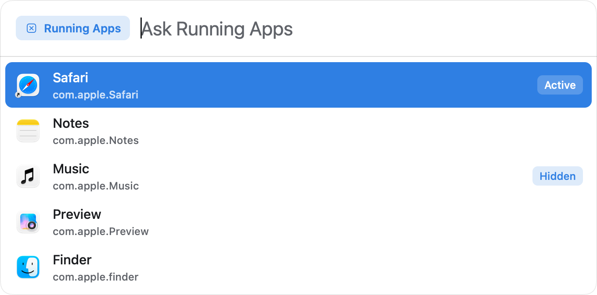
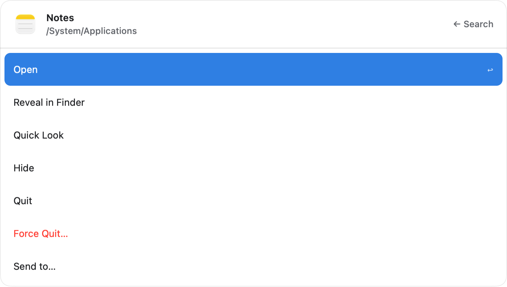

# Running apps

Dupin lists the apps that run now and hides, quits or force quits one without switching to it, from its own list or from any app's actions.

## Open it

Switch on **Running Apps** in Settings → Extensions, then type `quit` <kbd>Space</kbd>, and part of an app's name or bundle ID to find one, such as `quit sa` or `quit com.apple`. Or find an app in the main search, as always, and press <kbd>⌘K</kbd>.

## What you see

- Under `quit`, one row per app with a place in the Dock: its name, its bundle ID, and **Active** on the app in front or **Hidden** on a hidden one. Background apps and Dupin itself aren't listed.
- The list as macOS reported it within the last 2 seconds: while the panel shows it, Dupin asks again and updates the rows.
- In an app's actions in the main search, **Hide**, **Quit** and **Force Quit…** after its own, while the app runs.

<picture>
<source media="(prefers-color-scheme: dark)" srcset="../images/running-apps/list-dark.png" />

</picture>

<picture>
<source media="(prefers-color-scheme: dark)" srcset="../images/running-apps/actions-dark.png" />

</picture>

## What you can do

<kbd>↩</kbd> quits the app; <kbd>→</kbd> or <kbd>⌘K</kbd> lists the rest:

| Key / action         | What it does                                                                                 |
| -------------------- | -------------------------------------------------------------------------------------------- |
| **Quit**             | Asks the app to quit, as the Dock's Quit does, and says whether it has                       |
| **Hide**             | Hides the app, as <kbd>⌘H</kbd> in it would                                                  |
| **Force Quit…**      | Stops the app at once, after you confirm, as the Force Quit window does; it can't save first |
| **Reveal in Finder** | Shows the app selected in Finder                                                             |

On an app row in the main search, **Hide**, **Quit** and **Force Quit…** do the same.

Other keys: [Keys](../usage.md#keys).

## Notes

- Off by default.
- Needs no macOS access: Dupin asks the app to quit or hide as the Dock does, with no Automation access of its own.
- An app that is asking whether to save, or refuses, hasn't quit: Dupin waits up to 2 seconds and says so rather than waiting on it. Answer the app, or use **Force Quit…**.
- The actions on an app row show only while the app runs. Dupin checks that when you open the actions, so typing never waits for it.
- A [hotkey](./hotkeys.md#rows) quits an app without showing the panel: name it as `running-apps/` and the app's bundle ID, such as `running-apps/com.apple.Safari`.

## Configuration

Running Apps has no setting in `config.toml`. Turn it on or off in Settings → Extensions, or ahead of time in `extension-grants.toml` beside `config.toml` ([Declaring them with Nix](./extensions.md#declaring-them-with-nix)):

```toml
version = 1

[packages."bundled:running-apps"]
enabled = true
```

To leave an action off app rows, name it in `hide`; to move it, in `order`, as for any app action ([Hide and order](./advanced.md#hide-and-order)):

```toml
[advanced.kinds.app]
hide = ["running-apps/quit_forcibly"]
order = ["open", "running-apps/quit"]
```

| Action          | Name                         |
| --------------- | ---------------------------- |
| **Hide**        | `running-apps/hide`          |
| **Quit**        | `running-apps/quit`          |
| **Force Quit…** | `running-apps/quit_forcibly` |

```toml
[bindings."ctrl+alt+q"]
target = "dupin"
command = "running-apps/com.apple.Safari"
```

<details>
<summary>Extension scopes</summary>

Running Apps holds three scopes, which Settings → Extensions lists with the extension:

| Scope          | Lets it                                                                  |
| -------------- | ------------------------------------------------------------------------ |
| `apps:read`    | See which apps are running                                               |
| `apps:control` | Hide, quit and force quit them, which only an action you chose may do    |
| `rows:app`     | Receive the path of an app row whose Hide, Quit or Force Quit… you chose |

As a bundled extension it has all three while it runs as shipped; revoking one there stops what it allows.

</details>

<details>
<summary>How it works and changing it</summary>

The list and the actions are TypeScript in [`extensions/running-apps`](../../extensions/running-apps), which reaches the apps through the [`apps` capability](./extension-permissions.md#apps). The actions on app rows are the package's [kind actions](./advanced.md#extensions), which it declares Dupin composes by default.

To change it, eject it and edit the copy:

```sh
dupin ext eject running-apps
```

A changed copy is your own extension, without the bundled one's grants, as [Overriding a built-in](./extensions.md#overriding-a-built-in) describes.

</details>
