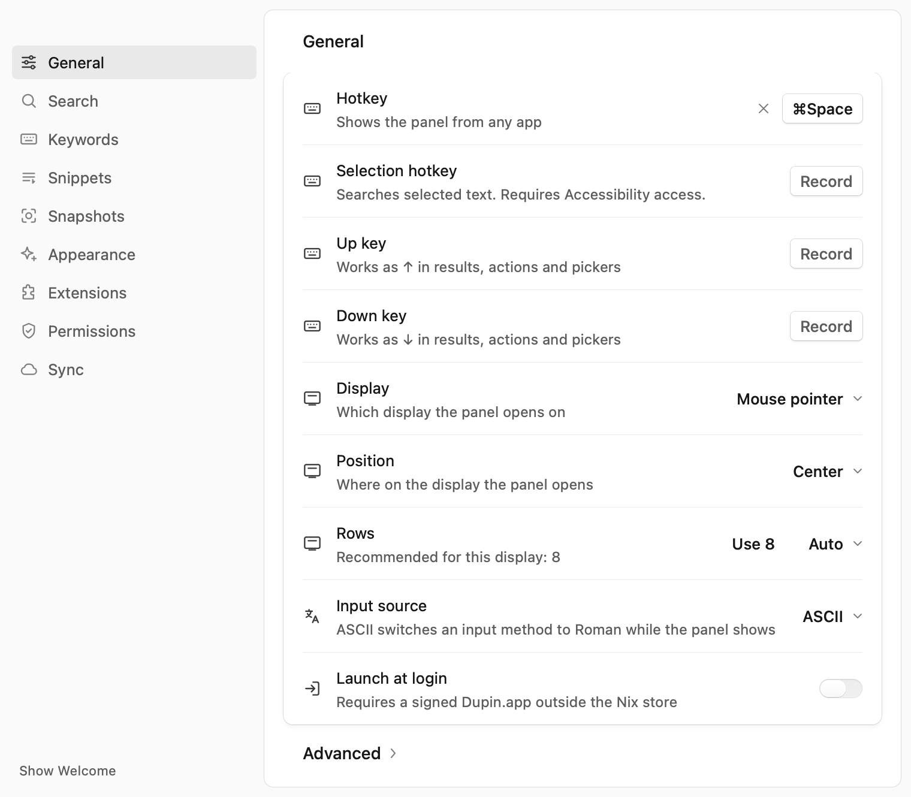
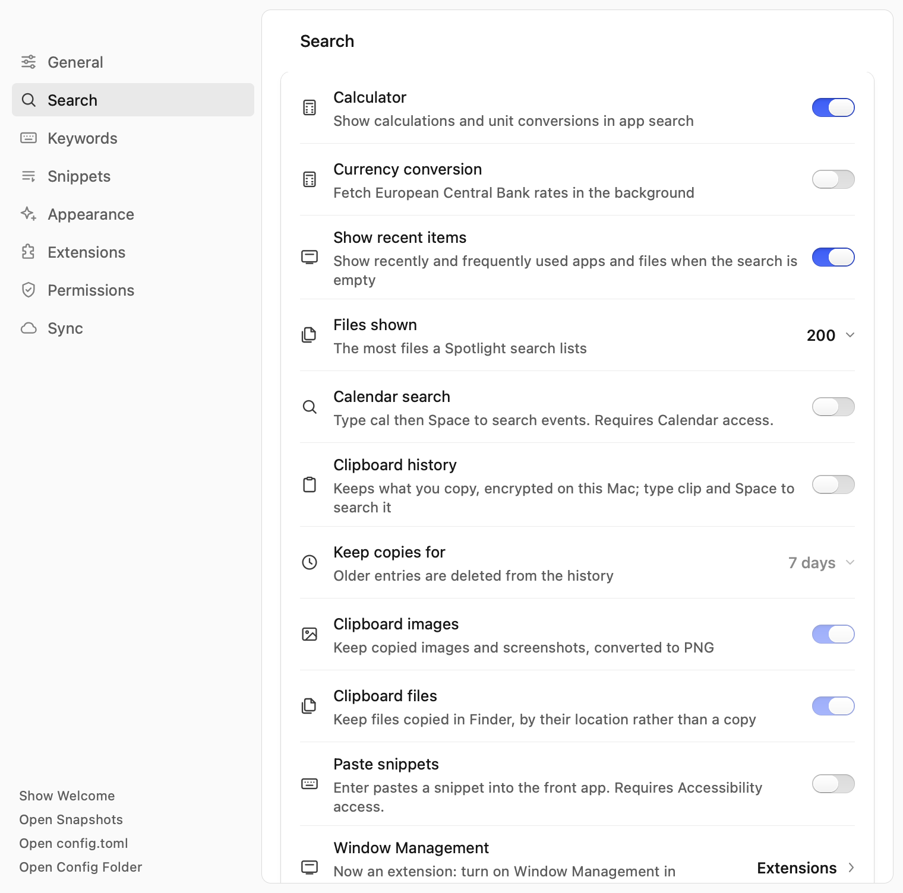

# Settings

Settings is Dupin's preferences window; the panel also finds macOS settings panes alongside apps.

## Open it

Press <kbd>⌘,</kbd> in the panel, or type `dupin settings` and press <kbd>↩</kbd>. See [Keys](../usage.md#keys).

## What you see

- A sidebar of pages: General, Search, Keywords, Snippets, Appearance, Permissions, Sync, Updates and more.
- At the foot of the sidebar: **Open config.toml**, **Open Config Folder**, **Show Welcome** and **Acknowledgements**.
- Rows a read-only `config.toml` sets are locked and marked **Managed by Nix** or **Set in config.toml**.

<picture>
<source media="(prefers-color-scheme: dark)" srcset="../images/settings/general-dark.png" />

</picture>

<picture>
<source media="(prefers-color-scheme: dark)" srcset="../images/settings/search-dark.png" />

</picture>

## What you can do

| Key / action                                               | What it does                                                                                                                                   |
| ---------------------------------------------------------- | ---------------------------------------------------------------------------------------------------------------------------------------------- |
| <kbd>⌘,</kbd> in the panel                                 | Opens Settings                                                                                                                                 |
| Type a pane's name, such as `bluetooth`, then <kbd>↩</kbd> | Opens that pane in System Settings                                                                                                             |
| Settings → Keywords                                        | Lists every keyword and edits your [aliases](./keywords.md#aliases) and the Dictionary and snippet keywords                                    |
| Settings → Snippets                                        | Lists every [snippet](./snippets.md#adding-and-editing), adds, edits and deletes the ones stored in Dupin, and shows `config.toml`'s read-only |
| **Launch at login**                                        | Starts Dupin at login; see [Launch at login](#launch-at-login)                                                                                 |
| **Relaunch**                                               | Restarts Dupin, installing a staged update first                                                                                               |
| **Open config.toml**                                       | Opens the file in its default editor                                                                                                           |
| **Open Config Folder**                                     | Shows the folder that holds it, with `extensions/` and `shaders/`, in Finder, creating it first if it doesn't exist                            |
| **Show Welcome**                                           | Brings back the [first-run](#first-run) welcome                                                                                                |
| **Acknowledgements**                                       | Opens the licences and copyright notices of the open-source code and data Dupin includes                                                       |

## Notes

- Settings saves to `config.toml` when it is writable. With a read-only file, other edits are saved in Dupin's [encrypted storage](./storage.md); see [Configuration](../configuration.md) for paths and precedence.
- Searching for a settings pane does not open or change settings.

macOS settings panes

Dupin discovers panes that the installed macOS declares as settings extensions and explicitly allows opening through its settings URL scheme; availability and names follow that macOS version. Searching does not open or change settings.

`dupin settings` uses the same window handoff as <kbd>⌘,</kbd>.

Locked rows

Settings saves to `config.toml` when it is writable. With a read-only file, the keys it sets are locked: rows show **Managed by Nix** when the file links into the Nix store, and **Set in config.toml** otherwise. Other edits are saved in Dupin's [encrypted storage](./storage.md).

Acknowledgements

Dupin.app carries the notices as `Contents/Resources/ThirdPartyNotices.txt`; `dupin --licenses` prints the same text.

## First run

The first launch opens Settings with a short welcome: choose the hotkey, turn on launch at login, and see which keys switch modes.

> [!TIP]
> <kbd>⌘Space</kbd> is Spotlight's shortcut too. To give it to Dupin, turn off Show Spotlight search in System Settings → Keyboard → Keyboard Shortcuts → Spotlight, or choose another hotkey. When another app holds the chord you press, Dupin names it.

When the welcome appears

The welcome appears once. It is skipped for anyone who used Dupin before: when its usage history exists in [encrypted storage](./storage.md#built-in-namespaces), or an older `history.json` in `~/Library/Application Support/Dupin` that Dupin has yet to move there. Its last step mentions [Settings → Sync](./sync.md) without asking anything about it. **Show Welcome** in the Settings sidebar brings it back.

## Launch at login

In Settings → General, turn **Launch at login** on or off. If macOS requires approval, choose **Open Login Items** and allow Dupin in System Settings; Dupin refreshes the status when you return.

Choose **Relaunch** in Settings → General to restart Dupin. If an update is already staged, relaunch installs it first.

> [!NOTE]
> This setting is managed by macOS and is available in the signed app bundle outside the Nix store. With Nix, use `launchd.enable`; see [Configuration › Nix](../configuration.md#nix).
