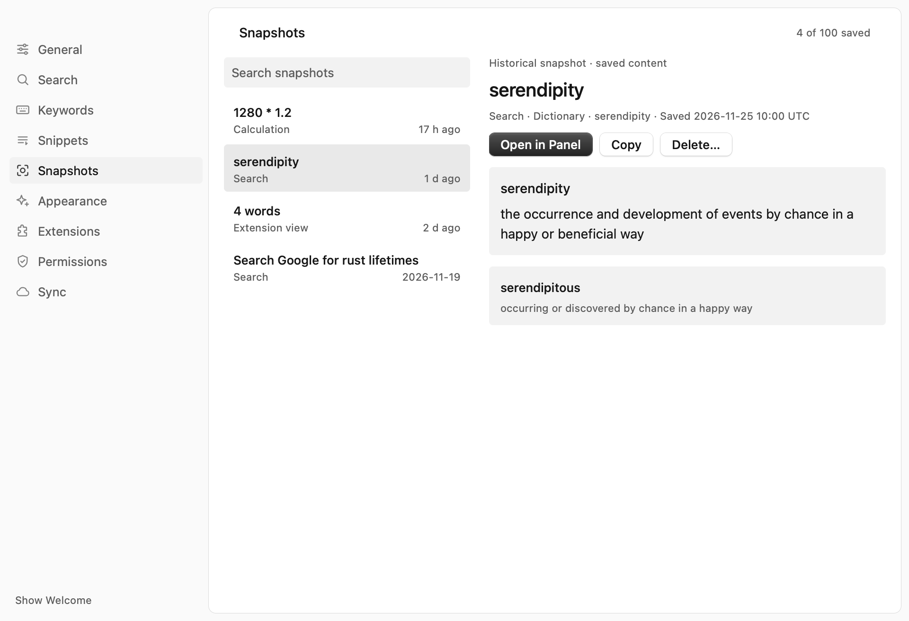

# Snapshots

Snapshots save a finished calculation, search or extension view so you can read it again later.

## Open it

- <kbd>⇧⌘S</kbd> in the launcher: save the current view.
- <kbd>⇧⌘O</kbd> in the launcher, **Snapshots** in the Settings sidebar, or type `Snapshots` and choose its row: open Settings on the Snapshots page.
- `snap` <kbd>Space</kbd>: list saved snapshots in the launcher.

## What you see

- In the launcher, saved snapshots by title, with when each was saved, its mode and its query, newest first.
- On the Snapshots page in Settings, a search field and the saved snapshots on the left, each with its title, its kind (calculation, search or extension view) and how long ago it was saved. The selected snapshot fills the right: its saved content, including the visible result list, and what you can do with it. The page's title shows how many of the 100 a Mac keeps are saved.
- With nothing saved, the page says so and how to save one.

<picture>
<source media="(prefers-color-scheme: dark)" srcset="../images/snapshots/settings-dark.png" />

</picture>

<picture>
<source media="(prefers-color-scheme: dark)" srcset="../images/snapshots/list-dark.png" />

</picture>

<picture>
<source media="(prefers-color-scheme: dark)" srcset="../images/snapshots/clip-dark.webp" />

</picture>

## What you can do

In the `snap` list:

| Key / action  | What it does                                                                  |
| ------------- | ----------------------------------------------------------------------------- |
| Type          | Filter by title                                                               |
| <kbd>↩</kbd>  | Open the selected snapshot on the Snapshots page                              |
| <kbd>⌘↩</kbd> | Resume its search, as <kbd>⌘R</kbd> does, when its command is still available |

On the Snapshots page:

| Key / action                             | What it does                                                                               |
| ---------------------------------------- | ------------------------------------------------------------------------------------------ |
| Type in the search field                 | Filter by title, query and saved content                                                   |
| Click a title, <kbd>↑</kbd> <kbd>↓</kbd> | Read it                                                                                    |
| <kbd>⌘F</kbd>                            | Focus the search field                                                                     |
| **Open in Panel**, <kbd>⌘R</kbd>         | Run the original mode and query again in the launcher, when its command is still available |
| **Copy**                                 | Copy the saved content as plain text, one paragraph per result                             |
| **Delete…**                              | Open a confirmation before removing the selected snapshot                                  |
| <kbd>Esc</kbd>                           | Cancel a pending delete, else clear the search                                             |
| <kbd>⌘W</kbd>                            | Close Settings                                                                             |

Other keys: [Keys](../usage.md#keys).

## Notes

- Nothing is captured automatically, and there is no telemetry.
- Snapshots hold what you typed and the results shown, so they are kept only in [encrypted storage](./storage.md) and stay on this Mac: they never sync.
- Storage accepts up to 100 entries, 512 KiB per entry and 8 MiB in total; a save that exceeds a limit reports an error and removes nothing.
- Viewing a snapshot never runs its saved actions. Editing the search field never deletes saved content.
- <kbd>⌘,</kbd> opens Settings on the last settings page you used, not on Snapshots; <kbd>⇧⌘O</kbd> opens Snapshots.
- Settings opens at 960 × 640 points the first time, smaller if the screen is, and then where you left it, at the size you left it. A window left on a display that has since gone, or larger than the screen it opens on, is moved and shrunk to fit.

## Configuration

Snapshots have no settings of their own. `snap` is their keyword; an [alias](./keywords.md#aliases) can name the `snapshots` command, and a [binding](./hotkeys.md) to it opens the `snap` list.

<details>
<summary>Command line</summary>

```sh
dupin snapshots list --json    # saved snapshot metadata
dupin snapshots open [--id ID] # show Settings on the Snapshots page
dupin snapshots close          # close Settings if it shows the Snapshots page
```

The list returns the ID, saved time, mode, title and query, and flags storage problems or truncation. These commands leave the saved snapshots and usage-ranking history intact. Opening dismisses the launcher and may retain the completed query for in-memory recall. An active picker blocks opening.

The [MCP server](./mcp.md) offers read-only `list_snapshots`, `read_snapshot` and `open_snapshot` tools over the same control socket, so an agent you connected can read what you saved.

</details>

<details>
<summary>How the list and resuming work</summary>

The `snap` list uses the metadata the Snapshots page reads, and reads the saved snapshots only when the keyword is entered before the page has; the main search never reads them. See [Keywords](./keywords.md) for `snap` and the other keywords.

A snapshot's kind follows what it saved: a calculation is one the calculator answered, an extension view one an extension's command answered, and anything else a search. Removed extensions leave their saved content readable. Extension-specific JSON state is reserved in the format; current commands resume through their query.

</details>

<details>
<summary>Storage details</summary>

Snapshots live in the `snapshots` namespace, one sealed record per snapshot. If the storage key can't be read, or the snapshots were sealed with another key, they stay on disk untouched, saving is refused, and the Snapshots page and every other Settings page say why; nothing is ever written in the clear instead. A record that was tampered with is dropped.

</details>
