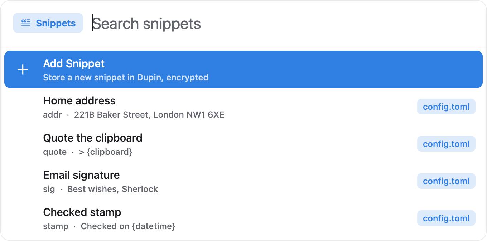

# Snippets

Type `snip`, then Space, to list your snippets ("Snippets"); type to narrow them by name or keyword. Each row shows the snippet's name, its keyword and the start of its text, and a snippet from `config.toml` is tagged **config.toml**. Enter copies the text, with any date, time or clipboard placeholders filled in, and closes the panel; paste it wherever you like. Backspace on an empty query returns to app search.

<picture>
<source media="(prefers-color-scheme: dark)" srcset="../images/snippets/list-dark.png" />

</picture>

With pasting turned on in Settings → Search, Enter pastes the snippet into the app you were using and ⌘Enter only copies it. The actions screen (Right Arrow or ⌘K) offers both. Turning on **Paste snippets** in Settings requests Accessibility access when needed. Snippets don't expand as you type in other apps.

Snippets you use often rank higher, as apps do.

## Adding and editing

The first row, **Add Snippet**, opens a form with a name, a keyword and the text; ⌘Enter saves it, and Esc leaves without saving. A snippet you added also offers **Edit Snippet** and **Delete Snippet** on its actions screen, and every row offers **Add Snippet**. Settings → Snippets lists every snippet and adds, edits and deletes the ones stored in Dupin there too.

Dupin stores the snippets you add in its [encrypted storage](./storage.md), never in `config.toml`. A snippet is checked as `config.toml`'s are, below: a keyword another snippet has, in storage or in `config.toml`, is refused with a message under the field. The launcher's form holds up to 16 KiB of text; a longer snippet is edited in Settings, and its row offers no Edit Snippet.

When there is no snippet at all, the Snippets command isn't suggested as you type a keyword and `?` doesn't list it, so an unused feature stays out of the way. Its keywords still work: `snip`, then Space, shows **Add Snippet**, where you add the first one.

## Configuration

`config.toml` can declare snippets too, as a read-only source: Dupin lists them beside the stored ones, and neither Settings nor the launcher changes them. Each entry under `snippets` is keyed by a short keyword and holds the text to copy, with an optional display name. Type `snip`, then Space, to list and search them (see [usage](#snippets)); `snippet_keywords` sets other aliases under the same rules as [`dictionary_keywords`](./dictionary.md#configuration), beside any in [`[aliases]`](./keywords.md#aliases).

```toml
snippet_keywords = ["snip"] # type any keyword, then Space, to search snippets
snippet_paste = false # whether Enter on a snippet also pastes it into the front app

[snippets.sig]
name = "Email signature"
text = """
Best wishes,
Sherlock"""

[snippets.stamp]
text = "Checked on {datetime}"

[snippets.quote]
name = "Quote the clipboard"
text = "> {clipboard}"
```

Placeholders are filled in when the snippet is used, not when it is listed:

| Placeholder   | Becomes                                             |
| ------------- | --------------------------------------------------- |
| `{date}`      | The local date, as `2026-01-31`                     |
| `{time}`      | The local time on a 24-hour clock, as `09:05`       |
| `{datetime}`  | Both, as `2026-01-31 09:05`                         |
| `{clipboard}` | The clipboard's text, or nothing when it holds none |

Any other braces are ordinary text, so code snippets need no escaping. Dupin reads the clipboard only when the snippet uses `{clipboard}`.

Keywords are case-sensitive, up to 32 bytes, without spaces. Names are up to 80 characters; text is required and up to 64 KiB. Dupin lists up to 10,000 snippets, stored and `config.toml`'s together, whose keywords, names and text together hold up to 1 MiB. Invalid snippets, and those past either limit in keyword order, are skipped with a notice in the panel; the rest still work. Edits apply live, including to an open snippet search.

When `config.toml` and storage both have a snippet with the same keyword, `config.toml`'s is listed and used, and a notice names the keyword: the file is the declared base, which a stored snippet never silently replaces. Rename the stored one in Settings → Snippets. The [sync design](../design/sync.md#snippets) keeps the same rule once snippets sync: `config.toml`'s wins on its own Mac and is never synced.

Dupin never writes `config.toml`'s snippets, whether the file is writable or one Home Manager makes read-only: Settings → Snippets lists them as they are, and to store one in Dupin instead, add it there and delete it from the file.

With `snippet_paste = true`, Enter also pastes the snippet into the app you were using by pressing ⌘V. If you enabled it through `config.toml`, Dupin requests Accessibility access on the first paste that needs it. While access is unavailable, Dupin copies the text. Later attempts also explain how to grant access. Settings → Search shows an Open button for System Settings → Privacy & Security → Accessibility.

## How it works

Snippets are the [bundled extension](./extensions.md#bundled-extensions) `snippets`, a TypeScript package in [`extensions/snippets`](../../extensions/snippets) that ships inside Dupin.app. It answers the `snip` keyword and your `snippet_keywords`. Settings → Extensions lists it as a built-in command, with where it comes from, its package switch and its grants, as [Overriding a built-in](./extensions.md#overriding-a-built-in) describes. The package reads neither `config.toml` nor storage: Dupin checks the snippets as above and hands the valid ones, each with where it comes from (`"source": "config"` or `"stored"`), and `snippet_paste`, to the shipped package as its read-only [`ctx.preferences`](./extensions.md#itemsctx). The package lists them once with [`items()`](./extensions.md#itemsctx), and again only when they change; Dupin matches what you type against each name and keyword itself, so typing runs no extension code.

Stored snippets live in the `snippets` namespace of Dupin's [encrypted storage](./storage.md), the one the [sync design](../design/sync.md#snippets) names, one record per snippet keyed by its keyword, so sync can carry them later without a migration; for now they stay on this Mac. Dupin reads them on a worker thread when it starts, and only once something was stored there, so a Mac without stored snippets never reads the storage key for them. The form's Save and the Delete action call the [`snippets`](./extensions.md#snippets) capability, which only an action you chose may use; Dupin checks and stores the snippet, hands the package the new list before the action answers, and the list shows it at once.

Each row's copy and paste actions are [templates](./extensions.md#actions): Dupin fills the placeholders when you choose one, so the extension never sees the time or your clipboard. Pasting goes through the extension's `clipboard:paste` scope and editing through its `snippets` scope, which the shipped package holds from the start; Accessibility access stays Dupin's to ask for, as above.

To change how snippets are listed, copy the package into the extensions folder and edit it:

```sh
dupin ext eject snippets
```

While the extensions folder is on, your copy answers the snippet keywords in place of the bundled one, as [Overriding a built-in](./extensions.md#overriding-a-built-in) describes. Once it differs from the bundled package it is a third-party extension: Dupin no longer hands it your snippets or fills its templates, and it must be allowed to paste, and to change your stored snippets, before Dupin asks macOS for Accessibility access or stores anything for it. Delete the copy to go back. `dupin ext test` replays the package's [fixtures](./extensions.md#fixtures) in `extensions/snippets/fixtures`, whose `snippets` calls change the snippets they hand the package as Dupin's do.
