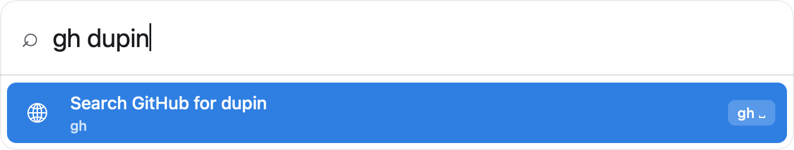
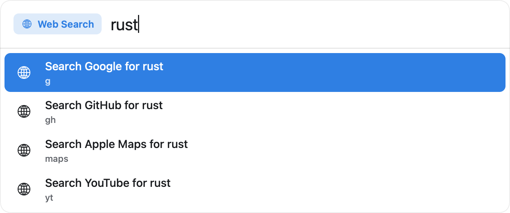
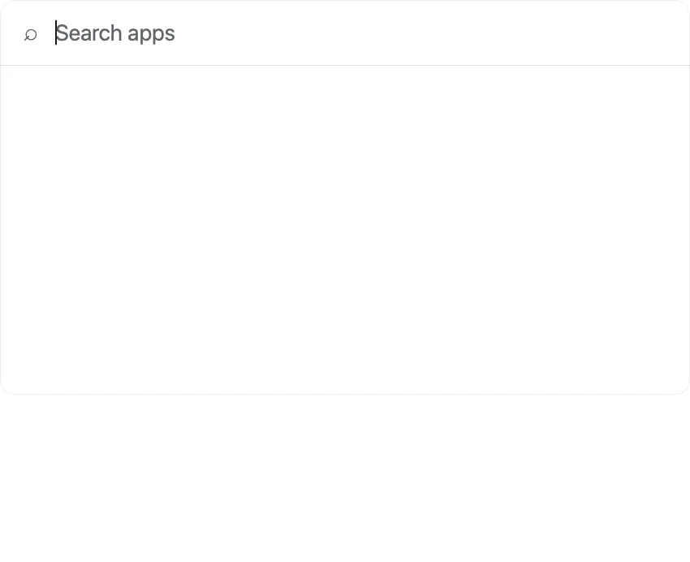

# Web searches

A keyword and a query open a search on Google, GitHub, YouTube or any site you configure.

## Open it

- A keyword, <kbd>Space</kbd> and a query: `g rust lifetimes`, `gh dupin`, `yt piano`.
- `web` <kbd>Space</kbd> and a query: list every web search for it.

## What you see

- The search as the first result, alongside any matching apps.
- A globe and the search's keyword as a tag on each web search row.
- The search's row as soon as you type its keyword, or the start of it, such as `y` ([Keywords](./keywords.md)).

<picture>
<source media="(prefers-color-scheme: dark)" srcset="../images/web-searches/alias-dark.png" />

</picture>

<picture>
<source media="(prefers-color-scheme: dark)" srcset="../images/web-searches/every-search-dark.png" />

</picture>

<picture>
<source media="(prefers-color-scheme: dark)" srcset="../images/web-searches/clip-dark.webp" />

</picture>

## What you can do

| Key / action                       | What it does                                            |
| ---------------------------------- | ------------------------------------------------------- |
| <kbd>↩</kbd>                       | Open the search in the default browser                  |
| <kbd>⇥</kbd> on a keyword-only row | Add a space, ready to type the query                    |
| **Send to…** on selected text      | Offers each web search for it ([Send to](./send-to.md)) |

Other keys: [Keys](../usage.md#keys).

## Notes

- Typing a query sends no network request. Dupin encodes the query into the URL when it builds the result and opens the browser or Maps only on activation.
- Web results do not count towards usage ranking. Query recall behaves as it does for other app-mode searches.
- A custom `web_searches` table replaces the defaults, so add the `maps` entry below to keep [Apple Maps](./maps.md).
- Turning off the **Web Search** extension in Settings → Extensions turns every web search off.

## Configuration

```toml
web_fallbacks = ["gh"]

[web_searches.gh]
name = "GitHub"
url = "https://github.com/search?q={query}"

[web_searches.maps]
name = "Apple Maps"
url = "maps://?q={query}"

[web_searches.docs]
name = "Rust documentation"
url = "https://doc.rust-lang.org/std/?search={query}"
```

| Key                      | Default                                                          | Meaning                                                                                                                                                |
| ------------------------ | ---------------------------------------------------------------- | ------------------------------------------------------------------------------------------------------------------------------------------------------ |
| `web_searches.<keyword>` | `g` (Google), `gh` (GitHub), `maps` (Apple Maps), `yt` (YouTube) | A web search: a display `name` and a `url` template with one `{query}`. An explicit table replaces the defaults; `web_searches = {}` disables them all |
| `web_fallbacks`          | `[]`                                                             | Keywords, in display order (up to 20), shown only when app-mode providers finish without a match                                                       |

An [alias](./keywords.md#aliases) such as `goo = "web:g"` gives a web search another keyword. File and Dictionary modes keep their own providers.

<details>
<summary>URL templates</summary>

Each entry has a display name and an HTTP or HTTPS URL template with exactly one `{query}` in its path, query or fragment. The exact template `maps://?q={query}` opens Apple Maps directly. Dupin encodes the text as UTF-8 URL data. Templates cannot contain credentials or put the placeholder in the origin. A name may not contain `{query}`.

</details>

<details>
<summary>Keyword rules</summary>

Keywords contain up to 32 ASCII letters, digits, underscores or hyphens, and are case-sensitive.

`in`, configured Dictionary aliases and snippet aliases such as the default `snip` take precedence over web searches, and web searches over extension keywords ([who gets a keyword](./keywords.md#who-gets-a-keyword)). `cal` and `clip` also take precedence when Calendar search and clipboard history are enabled, respectively.

Invalid or conflicting web searches, the default ones included, and fallbacks without one are skipped with a notice; valid entries still work. Changes apply live to the active search; no browser is opened by a configuration reload.

</details>

<details>
<summary>How it works</summary>

Web searches are the bundled **Web Search** extension, [`extensions/web-search`](../../extensions/web-search), which lists them as [web search items](./extension-api.md#web-searches). Dupin matches the keyword and fills the URL itself, so typing never waits on the extension. When another command, such as a Dictionary or snippet alias or a `web` entry in `web_searches`, uses its keyword `web`, Settings says so and only typing `web` to list every search stops working.

`dupin ext eject web-search` copies it into the extensions folder. An unchanged copy behaves as the bundled one. Once you change it, it is a third-party extension: it no longer receives `web_searches` or `web_fallbacks` from config.toml, and its web searches are listed only under its keyword `web`. Only the bundled package, or an unchanged copy, adds aliases and fallbacks to the main search and searches to Send to, so no other extension can put a search there that receives what you type.

</details>
