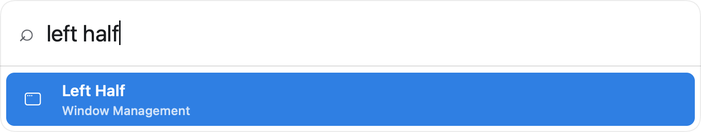

# Window management

Dupin moves and resizes the front app's focused window to a half, a third, the whole screen or the next display.

## Open it

Switch on **Window Management** in Settings → Extensions, then type a command name such as `Left Half`, `Centre Third` or `Maximise` in the main search, or `window` <kbd>Space</kbd> to list them all.

## What you see

- One row per matching command, with Window Management under its name.
- `Center`, `Center Third` and `Maximize` find the same commands, as does `window` before a name, such as `window left half`.

<picture>
<source media="(prefers-color-scheme: dark)" srcset="../images/window-management/commands-dark.png" />

</picture>

<picture>
<source media="(prefers-color-scheme: dark)" srcset="../images/window-management/clip-dark.webp" />

</picture>

## What you can do

<kbd>↩</kbd> on a command moves and resizes the focused window of the app that was in front when you opened the panel, then hides Dupin:

| Key / action                                      | What it does                                                                                              |
| ------------------------------------------------- | --------------------------------------------------------------------------------------------------------- |
| **Left Half**, **Right Half**                     | Puts the window on the left or right half of the display's usable area, outside the Dock and menu bar     |
| **Top Half**, **Bottom Half**                     | On its top or bottom half                                                                                 |
| **Left Third**, **Centre Third**, **Right Third** | On a third of its width                                                                                   |
| **Maximise**                                      | Over the whole usable area                                                                                |
| **Centre**                                        | In the middle, at its current size where it fits                                                          |
| **Next Display**                                  | On the next display, in the same place relative to the usable area, shrunk only if it is too large for it |

Other keys: [Keys](../usage.md#keys).

## Notes

- Off by default.
- Needs macOS Accessibility access. Turning Window Management on in Settings → Extensions asks macOS for it if Dupin hasn't asked before. Otherwise the first command you choose shows **Request Access** above the results, or choose **Request Access** in Settings → Permissions, where Accessibility lists Window Management among the extensions that use it.
- A window spanning displays is arranged on the one it overlaps most.

## Configuration

Window Management has no setting in `config.toml`. Turn it on or off in Settings → Extensions, or turn it on ahead of time in `extension-grants.toml` beside `config.toml`, the broker's read-only base ([Declaring them with Nix](./extensions.md#declaring-them-with-nix)):

```toml
version = 1

[packages."bundled:window-management"]
enabled = true
```

Dupin still accepts the `window_management` key that Settings once wrote to `config.toml`, ignores it and leaves it out the next time it saves.

<details>
<summary>Extension scopes</summary>

Window Management holds two scopes, which Settings → Extensions lists with the extension:

| Scope             | Lets it                                                            |
| ----------------- | ------------------------------------------------------------------ |
| `windows:read`    | See the displays and the focused window                            |
| `windows:arrange` | Move and resize that window, which only a command you chose may do |

As a bundled extension it has both while it runs as shipped; revoking either there stops it.

</details>

<details>
<summary>How it works and changing it</summary>

The commands are TypeScript in [`extensions/window-management`](../../extensions/window-management), which computes each frame from the displays and asks Dupin to move the window through the [`windows` capability](./extension-permissions.md#windows).

To change what a command does or add one, eject it and edit the copy:

```sh
dupin ext eject window-management
```

A changed copy is your own extension, without the bundled one's grants, as [Overriding a built-in](./extensions.md#overriding-a-built-in) describes.

</details>
