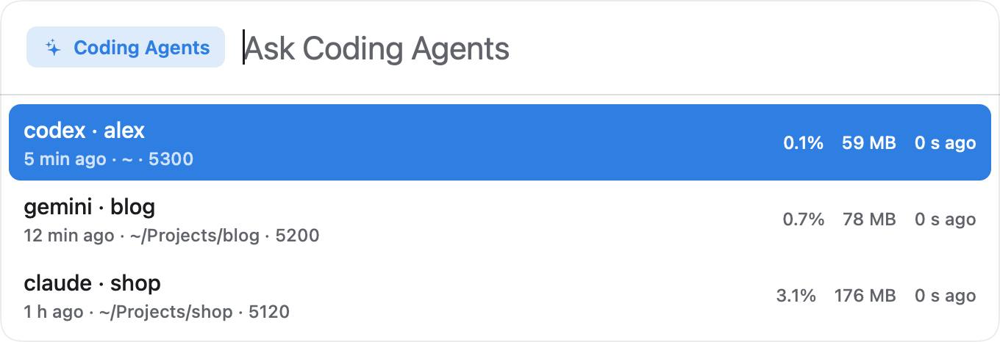

# Philosophy

**Back to basics.**

**A launcher should be the doorway to your desktop, not a replacement for it.**

Dupin is what Alfred was meant to be, as its author sees it: a launcher built for searching, simple and extensible, with extensions that agents can write.

It owes its shape to LaunchBar, Quicksilver, Alfred, Spotlight and Raycast, and to everyone who made them ([the name](./name.md) tells their story). Its model of sources, filters and kinds, which you compose yourself, comes from Shougo Matsushita's [unite.vim](https://github.com/Shougo/unite.vim), [denite.nvim](https://github.com/Shougo/denite.nvim) and [ddu.vim](https://github.com/Shougo/ddu.vim). Thank you.

<DesignChoices>

</DesignChoices>

## Back to basics

温故知新: revisit the old to understand the new. Press the hotkey, type a few letters and press <kbd>↩</kbd>; a short [keyword](./features/keywords.md) and <kbd>Space</kbd> reaches anything else, and <kbd>?</kbd> lists every one. That is the whole interface, and it stays that way.

<picture>
<source media="(prefers-color-scheme: dark)" srcset="images/philosophy/basics-dark.webp" />

</picture>

Alfred's muscle memory, and how Dupin learns from your picks

Dupin keeps Alfred's muscle memory as its default: <kbd>Space</kbd> on an empty query enters file search, and `in` and <kbd>Space</kbd> searches inside files ([Files](./features/files.md), [Using Dupin](./usage.md#keys)). You switch kinds of search with your hands, without learning or assigning extra shortcuts, and it is one of the parts of Alfred the author values most.

It learns from what you pick, as LaunchBar and Alfred do. Dupin remembers which result you opened for which query, so the same query puts it first among matches as good as it, and a shorter query that begins a longer one you used ranks it higher too. A pick counts less as it ages, so an old habit gives way to a new one. Beside that it keeps frecency, how often you opened something weighted towards recently, with the age buckets Firefox's address bar uses. Both live in [`history.rs`](../crates/dupin-core/src/history.rs), and neither ever lifts a scattered match over a query typed from the start of a word. So the same few letters reach what you want each time, and you get faster the more you use it ([Apps](./features/apps.md) documents the ranking).

## A doorway, not a replacement

A launcher at its best disappears: you call it, type a few letters, press <kbd>↩</kbd>, and it's gone. Nothing goes into the core that makes you spend time operating the launcher itself.

<LauncherLoop>

Hotkey, a few letters, ↩, gone.

</LauncherLoop>

<picture>
<source media="(prefers-color-scheme: dark)" srcset="images/philosophy/doorway-dark.webp" />

</picture>

## The panel is transient

The panel starts the work and a window keeps it: a [snapshot](./features/snapshots.md) opens in its own window to read later, and a script's output in the [Script Output window](./features/scripts.md#output-and-cancellation).

<PanelHandoff>

The panel starts the work and a window keeps it: a result goes to the Snapshots window, a script's output to the Script Output window.

</PanelHandoff>

<picture>
<source media="(prefers-color-scheme: dark)" srcset="images/philosophy/snapshots-window-dark.png" />

</picture>

Two kinds of speed

One is how fast you start something, which is the launcher's job. The other is how efficiently you finish the whole task: interrupting it, coming back to it, working on several things at once. That is what desktop windows are for. They hold your work in place, show several things at once, let you pause and return, and keep contexts apart. A panel that appears and vanishes can't do that, so Dupin doesn't try: it gets you started, then hands off. The panel suits quick, one-shot results: look something up, act, done.

## Same keys everywhere

<kbd>↩</kbd> opens, <kbd>⌘↩</kbd> runs the alternate action, <kbd>→</kbd> or <kbd>⌘K</kbd> shows the actions and <kbd>⌫</kbd> on an empty query backs out, in every search and every extension ([Keys](./usage.md#keys)).

<picture>
<source media="(prefers-color-scheme: dark)" srcset="images/philosophy/same-keys-dark.webp" />

</picture>

Objects, actions and kinds

Dupin draws every extension's views itself, so an extension can't invent its own controls, and what you learned once works in every extension.

Quicksilver's object and action survive as Dupin's kinds: every row is text, a URL, a file or an app, and its kind gives it actions. <kbd>⌘K</kbd> opens a file's [actions](./features/file-actions.md), such as Open with…, Move to… and Send to…, and [`[advanced]`](./features/advanced.md#kind-actions) adds your own actions to every row of a kind, run by a script, a URL or an extension. [`[aliases]`](./features/keywords.md#aliases) adds your own shorthands for a command, an app, a web search or a file.

## What Dupin won't build into the core

These are Dupin's choices about where a launcher's job ends. Each of them could be an [extension](./features/extensions.md), which is what the extension platform is for.

- Note taking.
- AI chat inside the panel.
- Team and collaboration features.
- Dashboards and other app-like views that hold state and need the panel to stay open.

## Fast, by rule

Dupin competes on the distance from intent to result rather than on breadth of features, and CI measures it: how many keystrokes until what you want is first ([Search quality](./development.md#search-quality)), and how long each keystroke takes to show its results ([Keypress latency](./development.md#keypress-latency)).

<LatencyFigure>

Under 3 ms from a keystroke to the first frame that shows its results, in the main search, at the 95th percentile, measured by CI on every change to the app.

</LatencyFigure>

<picture>
<source media="(prefers-color-scheme: dark)" srcset="images/philosophy/keystrokes-dark.webp" />

</picture>

How it is measured

Dupin stays running in the background with no Dock icon, so the panel is there the moment you press the hotkey.

CI measures how long a keystroke takes to reach the first frame that shows its results, on every change to the app. In recent runs the main search is under 3 ms at the 95th percentile, and every search measured is under 3.5 ms. A pull request's figures are compared with main's and any regression is reported on it; a shared runner's noise is larger than many real changes, so that comparison doesn't block a merge. What does is a bundled extension falling behind the native feature it replaced, or, for one with no native counterpart, going over its budget.

## Extensions agents can write

An [extension](./features/extensions.md) is a TypeScript or JavaScript package: text that you, or an agent, can write, test against fixtures and render from the command line. This clip is `dupin ext render --record` replaying the Notes example's fixture ([Testing and rendering](./features/extensions.md#testing-and-rendering)).

<picture>
<source media="(prefers-color-scheme: dark)" srcset="images/extensions/notes-dark.webp" />

</picture>

Why text first

In the author's experience, Alfred's workflows are hard to write by hand: they are made in the [Workflow Editor](https://www.alfredapp.com/help/workflows/), where you place objects on a canvas and connect them. They are stored as plist files and can be generated by a program, but that isn't how they are meant to be made, and the result is hard to read or review as text ([Workflow Configuration](https://www.alfredapp.com/help/workflows/workflow-configuration/)). That is why Dupin's extensions are text first.

An extension's manifest is in its `package.json`, and `dupin ext test` and `dupin ext render` check it against fixtures. The calculator, calendar, clipboard history, dictionary and the other [bundled extensions](./features/extensions.md#bundled-extensions) are built the same way, and you can eject any of them to change it.

Sandboxed, and no store

Dupin draws an extension's views; the extension runs in QuickJS-ng in a sandboxed helper process and reaches nothing on its own. Each declares the capabilities it wants, such as one website or a folder you pick, and you allow each one and can revoke it ([Asking for more](./features/extension-permissions.md#asking-for-more)).

There is no store. Packages are installed from Git and pinned by commit ([Installing and updating](./features/extensions.md#installing-and-updating)). To find what others have written, `dupin ext search` lists GitHub repositories with the `dupin-extension` topic, marked unreviewed, because the capability broker, not a review, protects you ([Finding packages](./features/extension-distribution.md#finding-packages)).

## In the age of AI agents

AI moves from use time to build time. An agent builds the tool once; from then on you use it with one keyword, at the same speed and with the same result every time, with no tokens spent and no model to wait for.

<picture>
<source media="(prefers-color-scheme: dark)" srcset="images/philosophy/agents-dark.png" />

</picture>

[Coding Agents](./features/coding-agents.md), rendered here from its test fixture, is one such tool: plain TypeScript that lists the agents at work, with no model behind it.

**A launcher for the age of AI isn't a launcher with AI built in; it's a launcher for people that AI can extend.**

Two paths: one for people, one for agents

An agent writes an extension in plain TypeScript and checks it with `dupin ext test` and `dupin ext render`, or through the MCP `ext_*` tools with `dupin mcp --workspace` ([Testing and rendering](./features/extension-testing.md#testing-and-rendering), [MCP](./features/mcp.md)). The result works offline unless the extension itself needs the network. That keeps AI's flexibility for making and a fixed tool's speed and certainty for using. Extensions run sandboxed with only the permissions you grant, so code an agent wrote is safe to run every day ([Extension permissions](./features/extension-permissions.md)).

When you know what you want, a few letters beat describing it to a model and waiting; agents shine when the goal is vague or the steps are many. So Dupin keeps the direct path as fast as it can be for people and gives agents their own, `dupin … --json` ([CLI](./features/cli.md)) and MCP, instead of squeezing both into one interface. The bridge goes both ways, and the final choice stays yours: picking from ranked candidates in a moment is the fastest way to decide, so with MCP's `pick` an agent shows its choices in the panel and you answer with a few letters and <kbd>↩</kbd>.

## Where your data lives

There is no account. What Dupin keeps stays on your Mac, [encrypted](./features/storage.md), and if you turn on [sync](./features/sync.md) it travels between your Macs through a folder you already sync.

Dupin is for macOS on Apple silicon.
