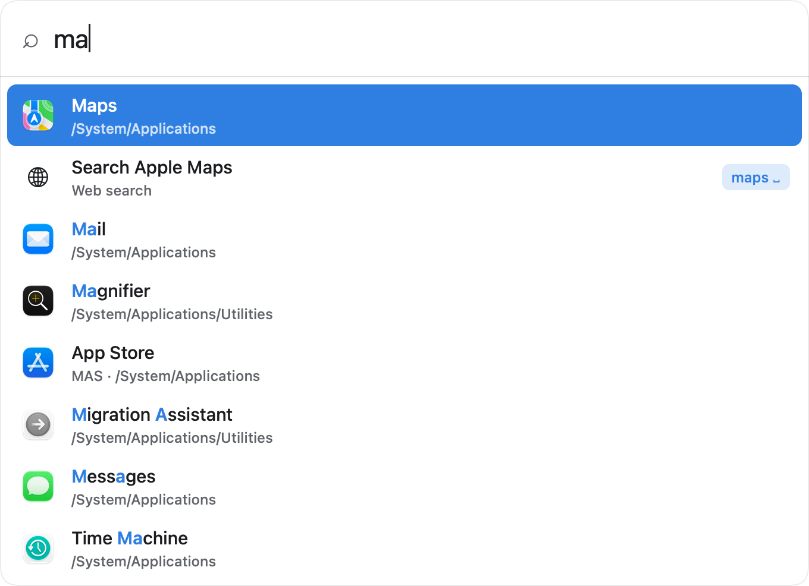

# Using Dupin

Why Dupin works this way: [Philosophy](./philosophy.md).

Dupin runs in the background with no Dock icon or menu bar. Press its hotkey (⌘Space by default; see [Configuration](./configuration.md)) to show the panel, type, and press ↩. Press the hotkey again, Esc, or click elsewhere to hide it.

<picture>
<source media="(prefers-color-scheme: dark)" srcset="images/usage/search-dark.png" />

</picture>

## Keys

| Key                                     | In the panel                                                                      |
| --------------------------------------- | --------------------------------------------------------------------------------- |
| Hotkey                                  | Show or hide the panel                                                            |
| Type                                    | Fuzzy-search installed apps                                                       |
| Space on an empty query                 | Search files with Spotlight, by file and display name                             |
| `in` then Space                         | Search inside files with Spotlight, as Alfred's `in`                              |
| `define` or `d`, then Space             | Look up a word in macOS dictionaries                                              |
| `clip` then Space                       | Search the clipboard history, when it is on                                       |
| `emoji` then Space                      | Pick an emoji or symbol                                                           |
| `snap` then Space                       | List saved [snapshots](./features/snapshots.md)                                   |
| `?`                                     | List every command and its keyword ([Keywords](./features/keywords.md))           |
| ⌫ on an empty query                     | Leave a folder or the current search mode                                         |
| ↑ ↓                                     | Move the selection                                                                |
| Tab at the end of an unselected input   | Complete the selected keyword or enter the selected command, or browse the folder |
| ↑ on an empty query, then ↑ ↓           | Recall searches in the current mode                                               |
| ↩                                       | Open the app or file                                                              |
| ⌘↩                                      | Reveal the file in Finder                                                         |
| ⌘Y                                      | Preview the selected app or file with Quick Look                                  |
| → at the end of the input, ⌘K or Ctrl+K | Show actions for the selected result                                              |
| Esc, or clicking elsewhere              | Hide the panel                                                                    |
| ⌘Q                                      | Quit Dupin                                                                        |
| ⌘,                                      | Open Settings                                                                     |

How search recall works

Completed searches are remembered for the current Dupin process when you clear the input, hide the panel or activate a result. With an empty input, ↑ recalls the latest term in the current mode from the first row; further ↑ and ↓ walk through those terms and back to the empty input. Editing a recalled term restores normal result selection. This history holds up to 100 terms and is separate from app-ranking history.

## Features

- **Searching**: [Keywords](./features/keywords.md), [Apps](./features/apps.md), [Recent items](./features/recent-items.md), [Files](./features/files.md), [Folder browsing](./features/folder-browsing.md), [File actions](./features/file-actions.md), [Send to](./features/send-to.md), [Dictionary](./features/dictionary.md), [Web searches](./features/web-searches.md), [Maps](./features/maps.md), [Calculator](./features/calculator.md), [Calendar](./features/calendar.md), [Clipboard history](./features/clipboard.md), [Snippets](./features/snippets.md), [Emoji & Symbols](./features/emoji.md), [Snapshots](./features/snapshots.md)
- **Commands**: [Script commands](./features/scripts.md), [Hotkeys](./features/hotkeys.md), [Search selected text](./features/selected-text.md), [Window management](./features/window-management.md), [Remote](./features/remote.md), [System commands](./features/system-commands.md)
- **The app**: [Settings](./features/settings.md), [Appearance](./features/appearance.md), [Permissions](./features/permissions.md), [Storage](./features/storage.md), [Sync](./features/sync.md), [Updates](./features/updates.md)
- **Extending**: [Extensions](./features/extensions.md), [Advanced composition](./features/advanced.md), [MCP server](./features/mcp.md)
